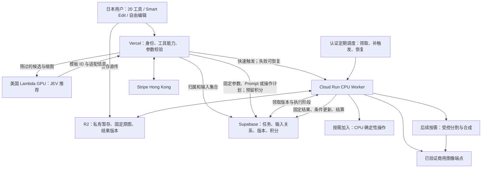

# 本轮交付状态

2026-10-19：已实现 Vercel Web 后端并补全接口；Cloud Run Worker、Lambda GPU JEV 仅提交设计待审阅，默认关闭生成。见 [后端说明](../backend/VERCEL_BACKEND.md) 与 [接口协议](../interfaces/INTERFACE_SPEC_V1.md)。下文为原始架构论证，能力通过与否仍依赖真实 evaluation。

# 20 工具技术能力与现有架构评审

日期：2026-10-19。范围依据：[BASELINE_REQUIREMENTS.md](../product/BASELINE_REQUIREMENTS.md)。本报告记录实现前的技术论证及调整建议；后续 Web 实现状态见上方交付说明。没有调用付费图像 API、运行模型或部署云服务，真实能力仍待 evaluation。

## 1. 结论与用户补充的设计重点

**现有服务拓扑可以承载初期 20 个效果并继续演进，但现有接口、数据与模型适配边界还需补齐。** 这里的“支持”是能表达任务、接入实际能力、可靠交付并允许升级，不是承诺首版把 20 个效果全部做成高精度专业工具。

用户已进一步明确：**20 个效果只是初期范围；不要求一次性把效果做到位，优先让架构适配后续模型能力迭代。** 因此，本报告区分首期必须建立的稳定边界、接入新模型时必须可扩展的能力，以及效果改进后再启用的增强处理。

Vercel、Supabase、R2、Cloud Run、JEV 和商业图像 API 的职责基本合理。建议保留这些边界，补齐轻量工具能力配置、类型化输入与参数、多输入资产关系、不可变原图、可恢复任务，以及模型/模板/费用版本。调色可逐步加入 CPU 处理；区域保护、分割和合成是增强候选，不作为所有效果首版交付的前置条件。

不能将“生成出一张图片”“供应商宣传支持编辑”“传了多个 image_id”视为能力已验证。架构应明确当前能力等级和限制，保留升级空间；效果未完善时允许继续迭代，但不能伪装成已具备精确保护等尚未实现的能力。

本文按最主要的现存问题将 20 工具分为：

- **A，8 项：通用编辑路径可承载。** 仍需结构化参数、输出约束与真实模型评测，未获得质量通过结论。
- **B，10 项：目标控制或保真需迭代。** 初期可从明确描述与预设开始；现有设计未定义能力档位与后续扩展接口。只有实测和产品承诺确有需要时才加入分割/合成，不要求首版全部实现。
- **C，1 项：适合逐步引入确定性处理。** 照片调色可用 CPU 像素运算改善保真、成本与时延；初期可保留明确标识的生成式风格调色，但不能宣称严格不重绘。
- **D，1 项：存在明确的核心契约缺口。** 多图合成缺多输入、角色和关系协议，当前请求与数据库单图字段不闭合。

四类是文档评审分类，不是模型成功率或开发工作量评级。全部 20 项仍在首期设计范围；不能把 B 类能力增强解读成“先把这些效果做到完美才能启动”。

## 2. 评审依据与判断边界

本地依据：技术包的 [系统架构](../../references/technical/02_SYSTEM_ARCHITECTURE.md)、[API 草案](../../references/technical/03_API_CONTRACTS.md)、[图像链路](../../references/technical/04_IMAGE_PIPELINE.md)、[推荐](../../references/technical/05_JEV_RECOMMENDATION.md)、[模板](../../references/technical/06_PROMPT_LIBRARY.md)、[账务和数据](../../references/technical/07_AUTH_BILLING_DATA.md)、[工具清单](../../references/technical/08_FEATURE_CATALOG.md)、[质量计划](../../references/technical/10_TESTING_RELEASE.md)。工作区当前是方案资料，缺少可用来证明实现完成的应用及测试结果。

外部核查仅确认平台公开能力和限制，不能替代中转商实测：

| 官方依据 | 本次确认的信息 | 对设计的影响 |
|---|---|---|
| [OpenAI 图像生成与编辑](https://developers.openai.com/api/docs/guides/image-generation) | 提供多图和蒙版编辑；蒙版属于引导，未保证精确遵循形状；人物一致性、精确布局仍有局限 | 多图和区域表达有上游选项，但不能承诺逐像素保护或自动获得身份保持 |
| [Google 图像生成与编辑](https://ai.google.dev/gemini-api/docs/image-generation) | 提供图文编辑、多参考图合成与连续编辑示例，具体规格随模型而异 | 商业模型存在实现路径；所选中转端点是否暴露能力须单独查证 |
| [Vercel Functions 限制](https://vercel.com/docs/functions/limitations) | Function 请求/响应载荷上限为 4.5 MB | 原图及多图继续直传 R2，不让 Web API 中转完整图像；推荐缩图需单独限字节 |
| [Cloud Run 请求超时](https://docs.cloud.google.com/run/docs/configuring/request-timeout) | 服务请求默认 5 分钟、上限 60 分钟；连接超时不代表容器停止；触发方也可能有更短超时 | 任务持久化、lease 和重入必须独立设计，不能把 HTTP 超时当作作业终止 |
| [Cloud Run 计费与 CPU](https://docs.cloud.google.com/run/docs/configuring/billing-settings) | 实例计费可在请求外分配 CPU | 现有按请求执行方案不应假设返回响应后持续工作；即使配置后台 CPU，仍需持久恢复 |
| [Cloud Tasks 限制](https://docs.cloud.google.com/tasks/docs/common-pitfalls)、[HTTP 任务](https://docs.cloud.google.com/tasks/docs/creating-http-target-tasks) | 可能重复执行；HTTP handler 默认 10 分钟、最高 30 分钟 | 换队列不提供上游“恰好一次”；如采用 Tasks，仍需幂等与分段执行 |
| [Cloud Scheduler HTTP 鉴权](https://docs.cloud.google.com/scheduler/docs/http-target-auth) | 支持认证 HTTP 目标和 OIDC | 可以为 PG 持久任务补独立恢复触发，不依赖浏览器在线 |
| [R2 预签名 URL](https://developers.cloudflare.com/r2/api/s3/presigned-urls/) | URL 到期前可重复使用 | 上传完成不等于原图不可变；需要从客户端可写暂存对象形成服务端控制的固定版本 |
| [Sharp 图像操作](https://sharp.pixelplumbing.com/api-operation/) | 提供亮度、饱和度、色相、色阶等操作 | 调色可在 CPU Worker 内实现，无需为此引入生成模型或 GPU 服务 |
| [Supabase RLS](https://supabase.com/docs/guides/database/postgres/row-level-security) | 服务端管理凭证可绕过 RLS | Worker 即使使用服务凭证也必须检查输入集合与任务归属，不能只依赖浏览器 RLS |

上述平台事实核查日期为 2026-10-19。以下架构选择和工具分组属于基于需求的工程判断。

## 3. 逐项能力总表

“输出”均需保存为私有版本，关联任务和输入集合，允许比较、下载与继续编辑；下表只写各工具额外差异。

| # | Tool ID / 工具 | 输入和关键参数 | 核心技术需求 | 当前结论 | 必要调整方向 |
|---|---|---|---|---|---|
| 1 | `remove_person` 去路人 | 单图；待删人物与保留人物 | 目标消歧、背景修补、非目标保持 | B | 目标字段、歧义澄清、区域控制接口 |
| 2 | `remove_object` 去杂物 | 单图；物体、位置、删除范围 | 区域修补、纹理与遮挡处理 | B | 区域/目标表达、保护区、边缘检查 |
| 3 | `change_background` 换背景 | 主体图；背景预设/文字，可选参考图 | 主体边界、遮挡、光照融合 | B | 主体保护模式、可选背景角色、合成能力 |
| 4 | `photo_color_grade` 调色 | 单图；色调、曝光、对比、强度 | 不改结构的确定性色彩变换 | C | 增加 CPU 图像处理执行方式和操作版本 |
| 5 | `weather_season` 天气/季节 | 单图；目标天气、季节、强度 | 场景一致、合理反射与阴影 | A | 参数范围、建筑/人物保持检查 |
| 6 | `light_time` 光线/时间 | 单图；时间、光向、强度 | 全局光照一致；区分提亮和重打光 | A | 两类处理语义与相应执行能力声明 |
| 7 | `ai_avatar` 社交头像 | 单图；人物、风格、构图 | 可辨认、方形安全裁切、头像输出 | A | 主体选择、风格参数、圆形显示安全区 |
| 8 | `natural_beauty` 自然美化 | 单图；人物、部位、强度 | 皮肤轻修、保五官与自然纹理 | B | 低强度约束、区域保护、脸部漂移评测 |
| 9 | `hair_color` 发色 | 单图；目标人物、颜色、强度 | 毛发定位与发丝边缘、肤色保护 | B | 头发目标和颜色语义，必要时分割改色 |
| 10 | `hairstyle` 发型 | 单图；人物、款式，可选风格参考 | 新发型生成、脸形与姿态保持 | B | 身份参考、参考角色、明确可变范围 |
| 11 | `professional_headshot` 职业头像 | 单图；人物、背景、服装与构图 | 身份保持、服装结构、自然面部 | B | 保真档位、输入适用检查、独立质量门槛 |
| 12 | `anime_photo` 动漫化 | 单图；风格、强度、主体范围 | 风格转换与人数、构图保持 | A | 区分风格与强度，独立多人测试 |
| 13 | `illustration_photo` 插画化 | 单图；媒介、风格、构图 | 视觉风格与关键特征保持 | A | 媒介参数及模板/模型适配记录 |
| 14 | `chibi_person` Q版 | 单图；人物、比例和风格 | 可控变形，保持标志性特征 | A | 单独定义比例变化许可，避免误用写实检查 |
| 15 | `pet_illustration` 宠物插画 | 单图；目标宠物、风格 | 毛色花纹、耳眼、动物数量保持 | A | 选择宠物主体，动物专用评价 |
| 16 | `pet_humanization` 宠物拟人 | 单图；拟人方式、服装、风格 | 特征映射、人体/动物结构可解释 | A | 定义拟人程度及允许的形体变化 |
| 17 | `multi_photo_composite` 多图合成 | 至少两图；顺序、角色、布局意图 | 多参考图、主体分配、融合、多人保持 | D | 多输入契约、关系表、真实端点验证 |
| 18 | `product_background` 商品背景 | 商品图；背景和阴影，可选参考图 | 商品形状、标签文字与颜色保护 | B | 严格保留商品的合成模式及保护区 |
| 19 | `room_redesign` 房间改造 | 单图；风格、可改家具/区域 | 固定门窗墙体与空间关系 | B | 可变/固定结构清单，几何失败评测 |
| 20 | `clothing_recolor` 衣服改色 | 单图；人物、衣物、目标颜色 | 局部改色，保护纹理、文字、皮肤 | B | 衣物定位、颜色/纹理语义，必要时分割改色 |

以上列的是能力维度和演进方向，不代表这些控制首版都必须实现，也不代表当前接口已经具备。初期主体/区域可先通过文字表达，参数只展示当前端点真实支持的部分；复杂控制不应变成用户必须填完的表单。参考图可选能力不等于强制增加每个工具的上传步骤，但输入资产的基础关系不能锁死成单图。

## 4. 逐工具论证与验证场景

以下“输出约束”用来识别质量风险和迭代目标。初期采用当前模型可达到、说明清楚的效果等级；不要求把所有强约束转成自动控制或自动判分。优先验证现有端点，只有短板影响实际用户价值时才引入增强处理。

### 01. 去除路人 — `remove_person`

- 必要输入：原图、可明确定位的待删人物；多人场景同时明确应保留主体。必须能表达“左侧红衣人”而不是只有模糊的“把人删掉”。
- 输出约束：指定人物被移除，背景重建合理，主角及未选人物不变形。被遮挡的真实背景不可恢复为可证明的原貌，只能合理补全。
- 现有覆盖：单图上传、模板、生成和交付有架构位置；缺结构化目标、歧义处理、目标范围与禁止变化的协议。
- 建议：清楚目标先用指令编辑；歧义时先让用户补充或轻量点选定位，再收费。区域或蒙版可作为内部控制，不要求上完整画布；若要保证区外不变，还需原图合成保护。
- 必测：孤立路人、多个相似衣着人物、人与主体交叉遮挡；不能误删主角或只留下残影。

### 02. 去除杂物 — `remove_object`

- 必要输入：物体描述、位置与目标范围；需要区分删除桌上杯子、杯子及阴影、还是整张桌子。
- 输出约束：删除完整、重复纹理连续，主体、文字和构图保持；阴影/反射属于目标关联区域，不总与物体轮廓重合。
- 现有覆盖：通用生成链路可试验；没有目标关联区域和保护区定义，模板不足以解决选择歧义。
- 建议：与去路人共享目标与区域模型，保留扩大修补区/保护区表达；仅在供应商和评测支持时宣称局部控制。
- 必测：规则瓷砖、物体覆盖文字、玻璃/反射物体、大物体遮挡背景。

### 03. 更换背景 — `change_background`

- 必要输入：主体图、背景文字或预设；如支持用户背景图，则其角色必须为 background_reference，不可与主体图互换。
- 输出约束：主体轮廓、毛发、手指和身份保持，接触阴影与光照合理。
- 现有覆盖：纯指令背景替换可走原链路；无主体保护方式，也没有参考背景资产角色。
- 建议：区分“创意融合”和“保留原主体”两种能力要求；后者需要可验证的分割/抠图和背景生成合成方案。若首期仅有前者，应在产品上明确，但仍论证后者缺口。
- 必测：发丝、宠物毛、透明眼镜、主体与背景同色、多人边界。不能承诺同一方案适配全部半透明主体。

### 04. 照片调色 — `photo_color_grade`

- 必要输入：色调预设与强度，或曝光/对比/饱和度等受限参数。自然语言可先映射为已支持的参数，不得默默变成整图生成。
- 输出约束：几何结构、人数和文字内容不变，色彩变化符合预设；颜色管理和导出规格明确。
- 现有覆盖：Cloud Run CPU 可承载处理，但当前“所有任务编译 Prompt 再调模型”的定义没有非生成任务。
- 建议：执行类型保持可扩展，逐步加入确定性图像操作并保存操作参数/版本；不为它新增服务。初期可先用生成式风格调色，但要说明可能重绘，不能冒充纯色彩调整。
- 必测：肤色、商品标签、细字、渐变；允许色彩变化，禁止形状重绘。成本与积分需适配没有上游推理费用的情况。

### 05. 天气/季节转换 — `weather_season`

- 必要输入：目标天气、季节、变化强度与应保留主体；相互冲突的要求在提交前处理。
- 输出约束：场景仍可辨认，地面、植被、天空与反射协调；照片文字和建筑不应无关变换。
- 现有覆盖：属于通用指令编辑适配场景，模板路径可承载；实际天气效果和结构保持尚无测试证据。
- 建议：工具参数白名单和独立质量档案，不额外预建气象服务；严格保留人物时需纳入主体保护能力。
- 必测：室内误入、无天空照片、人物近景、积雪与水面反射。

### 06. 光线/时间转换 — `light_time`

- 必要输入：目标时间、光向、强度；先区分“把暗照片提亮”和“把白天变成黄昏”。
- 输出约束：前者主要调整像素光色；后者允许重新推断阴影与照明，但主体身份、场景关系应稳定。
- 现有覆盖：生成式时间变换有路径；简单提亮的 CPU 路径、参数语义和路由还未定义。
- 建议：同工具声明两种处理能力，静态选择处理方式；不让模型自行决定计费或处理类别。
- 必测：逆光人像、混合光源、夜间噪声、明显投影；避免光源改变但影子方向完全不变。

### 07. AI 社交头像 — `ai_avatar`

- 必要输入：目标人物、艺术风格、背景/构图；通常单图即可，身份参考集合为可扩展能力。
- 输出约束：方形交付、主体在圆形头像裁切中不缺关键部位，风格化后仍可辨认。
- 现有覆盖：风格模板适合当前路径，但输出仅有通用 aspect_ratio，没有头像安全区与目标人物语义。
- 建议：加入头像输出预设、主体选择与裁切检查；如果要求写实高保真，复用职业头像的严格能力档位，不能把风格化成功等同写实身份保持。
- 必测：眼镜、帽子、边缘人脸、多人物合影、侧脸。

### 08. 自然人像美化 — `natural_beauty`

- 必要输入：目标人物、允许修饰部位与强度，默认轻修。多人人像需明确作用于谁。
- 输出约束：五官、脸形、肤色特征、皮肤自然纹理保持，不能默认改变年龄感和身体形态。
- 现有覆盖：文本保真约束存在，但没有低强度操作和区域保护保证；生成看起来更漂亮不足以判定完成。
- 建议：明确保真指标；优先测轻修模式，无法满足时评估受控局部处理或专门修饰能力。无需预先建设人脸识别数据库。
- 必测：雀斑、痘印、深浅不同肤色、多人、低光；人像身份评测以授权人工判断为基础。

### 09. 发色更换 — `hair_color`

- 必要输入：人物、发色目标、作用范围与强度；用户选择的是视觉近似色，不应承诺屏幕到真实染发色的精确一致。
- 输出约束：发丝边缘自然，脸、背景、帽子不被染色，保留发束明暗；黑发变浅会涉及亮度和纹理重建。
- 现有覆盖：Prompt 能描述目标，未提供头发区域、颜色参数或保护机制。
- 建议：把“定位头发→改色→边缘融合”列为能力要求；先测通用端点，失败时可用托管分割和 CPU 色彩操作，不默认增加自研 GPU 模型。
- 必测：卷发、飞发、帽子、黑发变金发、背景与头发同色；只改目标人物。

### 10. 发型尝试 — `hairstyle`

- 必要输入：人物、发型预设/文字，可选仅用于款式的参考图；参考图中的人不能替换用户身份。
- 输出约束：发型可改变遮挡和外轮廓，脸部身份、姿态和头部结构保持。遮住额头到露额头会产生补全，不能保证真实还原。
- 现有覆盖：风格模板可生成，但身份/款式参考角色、可变区域及失败判据缺失。
- 建议：身份与款式参考分开、限制参数组合；必要时用区域引导。不声称加一张人脸检测结果即可保证身份保持。
- 必测：刘海、短转长、长转短、侧脸、帽子遮发、多人物。

### 11. 职业头像 — `professional_headshot`

- 必要输入：人物原图、背景、服装预设、构图；是否允许多张身份参考由选定端点和产品体验共同决定。
- 输出约束：面部可辨认、服装与脖颈结构自然、眼镜等标记保持；不能以艺术化变化解释身份漂移。
- 现有覆盖：生成与存储能承载，但没有高保真档位、输入适用性与独立质量放行。
- 建议：将此工具与趣味头像分开评测；低清/极侧脸提示换图；必要时附身份参考，而不是以固定 Prompt 保证效果。
- 必测：眼镜、头发遮脸、肤色、肩颈、衣领；产品仍是消费级头像，不承诺证件认证用途。

### 12. 照片动漫化 — `anime_photo`

- 必要输入：风格、变化强度、主体范围和构图要求。
- 输出约束：人数、基本姿态和明显配饰保持，风格一致；允许绘画表现，不追求像素一致。
- 现有覆盖：最适合通用图生图与模板的场景之一；缺经过验证的风格—端点—参数组合。
- 建议：模板记录允许改变和必须保留项，输出规格受工具控制；不增加动漫专用服务作为前置条件。
- 必测：多人、手部、复杂眼镜、宠物混入、画面文字。

### 13. 照片插画化 — `illustration_photo`

- 必要输入：水彩/线稿等媒介、强度和是否保留背景。
- 输出约束：媒介特征明显，主体与构图仍可辨认；“自然水彩”和“忠实保持细节”可能存在张力。
- 现有覆盖：通用模板路线可承载；style_id、用户补充描述与保真约束的冲突处理尚未统一为工具参数。
- 建议：将媒介与保真档位作为显式选项，记录模板和模型版本，反馈与指标关联到具体组合。
- 必测：单人/多人、风景、细配饰、背景复杂度；不能只用自拍证明所有图片适用。

### 14. Q版人物 — `chibi_person`

- 必要输入：人物、头身比例风格、服装与背景处理方式。
- 输出约束：允许有意改变身体比例，但发型、衣着、代表配饰和人数仍需保持。
- 现有覆盖：通用编辑可承载；统一“结构差异越小越好”的评价会错误惩罚正常 Q版结果。
- 建议：在能力与质量档案中声明允许比例变化，不复用职业头像的写实阈值。
- 必测：多人、复杂服装、眼镜、手持物；分清合理夸张与多肢体错误。

### 15. 宠物插画 — `pet_illustration`

- 必要输入：目标宠物、风格、背景；多宠物可选择单只或全部。
- 输出约束：毛色分区、明显斑点、耳型、眼色和宠物数量保持。
- 现有覆盖：已有宠物模板示例，适合通用路径；示例的 sample_count 为 0，不能视为质量通过。
- 建议：工具与模板加入宠物主体及关键标记约束；人脸一致性方案不应直接套到动物。
- 必测：黑猫、黑白花纹、长毛遮眼、多宠物、小面积宠物。

### 16. 宠物拟人 — `pet_humanization`

- 必要输入：动物穿人类服装或完全人形化的明确模式、角色与风格。
- 输出约束：体形变化可被允许，毛色/标记或气质映射需可识别；预期结果不是精确保留原始解剖。
- 现有覆盖：通用模板可承载，但“拟人”的两种语义尚未拆分。
- 建议：在生成前展示模式与真实例子；模板记录允许的变化，不让用户以为只换衣服却得到完全人脸。
- 必测：猫狗以外动物、多宠物、深色花纹、服装与四肢结构。

### 17. 多照片合成 — `multi_photo_composite`

- 必要输入：至少两张独立授权图片；每图顺序和主体/背景/风格角色；谁放在什么位置的场景意图。最大张数需取产品限制与端点限制中的较小值，不能直接照抄上游最大值。
- 输出约束：保留指定主体及人数，不张冠李戴，比例、光照和遮挡合理。
- 现有缺口：EditRequest 是单 image_id，GenerationJob 为数组，edit_jobs 表又是 input_image_id；多对多资产关系和角色不存在，属于阻碍完整设计冻结的直接缺口。
- 建议：统一输入集合和角色；增加任务—输入关系、顺序与来源记录；端点实际多参考图支持必须采购验证。不能用客户端拼成一张图冒充已实现的语义多图编辑。
- 必测：人+宠物、两人合影、主体图+背景图、相似人脸、缺失或重复输入；对每图执行归属与就绪检查。

### 18. 商品背景美化 — `product_background`

- 必要输入：商品图、背景和阴影要求；可选背景参考。
- 输出约束：商品形状、Logo、标签文字、颜色和材质不被无关改变；创意重绘与真实陈列必须区分。
- 现有缺口：全图生成不能成为商品细节保护机制；没有保护区/合成方式和真实性质量档位。
- 建议：严格模式采用保留商品像素的抠图/背景生成/合成候选方案；阴影单独处理。半透明、反射商品不能由普通二值分割保证，需专项评测与能力边界。
- 必测：瓶身小字、透明玻璃、金属反光、细线商品、白物白底。商品真实性不等于图片媒体格式可读。

### 19. 房间风格改造 — `room_redesign`

- 必要输入：房间原图、风格、允许更换家具/材料的范围，固定门窗墙体等清单。
- 输出约束：门窗数量、主要墙线、视角与空间关系保持；作为风格预览不承诺施工尺寸精度。
- 现有覆盖：通用生成可尝试风格替换；固定结构和允许变化没有结构化表达。
- 建议：先测固定结构约束；如明显失真，评估区域/边缘/深度等控制能力是否由现有供应商提供，不能直接认定必须新建三维重建系统。
- 必测：广角、镜面、多扇门窗、斜墙、家具遮挡；记录不可能家具与结构缺失。

### 20. 衣服颜色更换 — `clothing_recolor`

- 必要输入：目标人物和衣物、颜色、改色强度；需要区分外套与内搭。
- 输出约束：皮肤、头发、背景不改色，衣物褶皱、纹理、Logo/文字保持。
- 现有覆盖：Prompt 可尝试，缺衣物区域和颜色参数；不能以重新生成另一件衣服判定成功。
- 建议：先测通用端点；若纹理/文字漂移，采用衣物分割与受控色彩变换候选方案。保留极黑/极白改色的质量限制，不能保证任何输入都等效。
- 必测：印花、条纹、多人同款、衣物与背景同色、手部遮挡。

## 5. 共性缺口与必要调整

### G01. 工具目录缺少可执行的能力声明

当前工具页字段主要是名称、模板、输入数量和 credits，API 主要只有自由描述、质量与宽高比，无法验证不同工具参数是否合法。

建议用轻量 Tool Spec 表达：输入角色及数量、当前参数与范围、执行方式、输出限制、允许端点、模板及费用版本、启用状态。保真要求与可用能力分开记录，避免把希望达到的效果误写成端点已经支持的控制。初期配置可以很少，不必做可视化配置平台。

工具能力与 Prompt 分离，避免把收费和权限写在 Prompt 里。强度这类产品语义需要区分“由 Prompt 近似表达”与“供应商有真实可控参数”，不能给所有模型造一个表面相同、实际不生效的滑块。

模板示例中的通用 parameters 可以装载部分信息，但应有可校验规范，不能作为未经验证的任意字典传给供应商。

### G02. 单图接口与多图数据模型不一致

需要统一编辑输入集合，保存资产 ID、角色、次序、目标说明；每张图验证归属、就绪、未删除、大小和用途。图片关系用任务—输入关联表达，避免只保留“主图”而丢失其他来源。

建议保留主图概念用于结果比较，同时允许多输入；模型不支持多参考图时应在提交前明确不支持，而不是忽略第二张图或收费后才报错。

### G03. 缺少目标、区域与保真策略

初期先支持语义目标与简短说明，不要求实现全套精细控制。工具能力声明应能区分文本引导与精确区域处理。未来引入点/矩形/蒙版或自动分割时，资产模型需能关联它们对应的归一化原图版本；坐标、缩放旋转和“编辑/保护”语义须一致。

“模型支持蒙版”仍不是区外逐像素不变。若需要严格保护，建议生成后与原图受控合成；过渡带、发丝、透明材质需单独处理。检查像素保持时以同一归一化画布的无损工作结果为准，不能要求 JPEG 重编码后的文件字节完全一致。

不建议为了全部工具预建一套复杂分割平台。应先定义需要保证的能力，再根据通用模型测试结果选择托管分割、受控合成或专用端点；这些方案是需验证的调整候选。

### G04. 执行模型只考虑了“调用生成 API”

照片调色、裁切、格式/色彩归一化可由现有 CPU Worker 完成。必要时局部改色/背景处理会是固定阶段组合。

初期在同一 Worker 内以商业模型编辑为主，避免任务记录硬编码成“只有一个 Prompt”。预留有限执行类型及处理版本，之后可增加确定性图像操作、受控前后处理；未实现的类型不能启用。按工具配置静态选择，不引入用户编排工作流或自动模型竞价。

Worker 仍只消费快照。Web 需在建任务时记录不可变参数及执行类型/版本，任务不能只剩 final_prompt；后续非生成任务也不应伪造模型调用。这里的执行计划可以是一个类型加固定参数，不要求初期建设通用步骤引擎。

### G05. 上传 ready 尚未保证资产不可变

R2 PUT 签名可重用，使“完成校验后原对象被再次写入”成为实际边界问题。只在 PG 保存 image_id 不足以固定生成输入。

建议客户端仅写暂存对象；服务端将其形成客户端不可写的规范版本，并对该固定版本解码校验、计算哈希和尺寸后标记 ready。Worker 使用固定版本而非客户端可写键；校验与后续读取必须针对同一份内容。

需定义 EXIF 方向、ICC/工作色彩空间、透明通道、手机 HEIC 支持或转换/提示、像素与字节上限。推荐缩图可先行，不代表原图已通过正式校验；前端生成的尺寸和类型不能直接作为服务端证据。

输入、结果、蒙版和预览分别管理用途与保留策略；排队期间不把短签名 URL 当作任务永久输入，在供应商实际取图前按需签发。

### G06. 连续编辑需要版本关系，且存在累积漂移

单 parent_image_id 可表达简单链，不能完整表达多图来源。建议任务输入关系保存全部来源，结果关联 job；单主线使用父版本，多图保留所有源关系。

继续编辑需明确“以当前结果为主图”还是“同时带原始身份/商品参考”。后者会增加输入数和成本，需要端点支持与角色规范；不能默认每轮无限附带所有历史图。

历史/列表、结果授权下载、分支重新编辑和删除协议尚缺。删除需考虑任务处理中途删除、父图删除对后续任务影响、孤立结果和延迟回调，避免删除后旧 Worker 又恢复资产。

### G07. PG 队列表存在，但缺一个可靠执行闭环

现有文件提到原子 claim、lease、扫描恢复，这是正确方向，但没有确定由谁、何时、以什么认证调用扫描；“Web 发一次请求然后返回”不能保证已提交任务持续执行。

首期建议：PG 作唯一任务事实源，创建任务与预留积分同事务；Web 可提供低延迟触发，但独立的认证定期调度负责扫描到期/未触发任务。扫描与单次执行必须有界，不常驻死循环，不依赖 Cloud Run 响应后持续运行。

异步供应商尽量分成提交、状态查询、结果保存和结算阶段，记录 next_poll_at、提交意图、供应商任务 ID、lease/领取版本、重试次数和截止时间。lease 过期后旧 Worker 的写入必须被领取版本或相等强度的条件更新拒绝。

Cloud Tasks 可在需要集中限流、稳定派发或更短排队时引入；20 工具数量本身不足以证明必须用它。如果采用独立队列，需要任务出箱/补发机制解决 PG 提交与队列投递无法同事务的问题，并仍处理重复执行与超时上限。

### G08. “不重复收费”有平台内外两种边界

平台内部可通过用户范围的幂等键、唯一业务流水与原子余额事务确保不重复扣积分。同一用户同幂等键但不同参数应拒绝冲突；另一用户的相同键不能复用前者任务。

外部调用在“供应商已受理、响应丢失”的窗口无法只靠 PG lease 证明恰好一次。优先选择支持幂等请求/请求号查询的供应商；否则需要结果不确定的阶段、查询与人工核对规则，不盲目重新提交。不能声称换 Cloud Tasks 就消除了上游重复计费。

结果保存失败只恢复保存阶段，不再次生成。R2 写入和 PG 结算不可能是一个本地数据库事务：先保存可重复确认的结果对象，再用条件事务登记归属并结算；数据库失败时恢复登记，孤立对象再清理。技术失败释放预留；不确定任务需有最长冻结时间和处理政策。已释放积分后收到晚到结果不得自动补扣，按既定规则记录平台损失或人工处理。

取消同样要分阶段：未提交上游可安全取消；上游受理后只能在端点支持时取消，否则记录取消请求并按已说明的交付/费用规则处理，不能将本地 cancelled 当成上游费用已撤销。

技术交付成功与用户认为“修得不好”要分开。后者需要反馈、重做/补偿政策和质量数据，不建议默认每图再调用一个昂贵视觉模型宣称自动判好坏。

### G09. JEV 推荐尚未理解工具能力与输入前置条件

单张照片可以提示多图合成，但不能因此认为用户已经具备第二张素材。推荐目录需带必需输入、需用户补充的信息、保真风险、端点可用与质量放行状态；推荐成功率不得与生成质量混为一谈。

Web 先过滤被禁用、无合格端点或当前不可执行的候选，JEV 负责视觉适配和多样性；对需补图的推荐明确说明。直接工具页仍可绕过 JEV。

JEV 不应被自动扩展成分割、人脸识别或几何控制服务。具体模型、许可证与 API 尚未确定，是否具备这些能力没有证据；如需增加职责，需独立评估 GPU 内存、并发与推荐延迟影响。

### G10. 输出和容量预算仍过于统一

输出需要按工具明确尺寸、比例、格式、透明度和最大像素；头像、房间、商品具有不同构图需求。未支持的参数在创建任务前拒绝，不应静默降级却按高规格收费。

任务成本至少关联输入数量/分辨率、输出质量、模型、前后处理、重试和价格版本；除供应商费用外，计入存储、网络及失败损失。模型调用数不等于用户任务数。

还需全局供应商限流、每用户并发、最大在途任务、费用熔断和队列等待指标；只限制单个 Cloud Run 实例不能控制整个部署的供应商调用量。

没有预计流量、供应商配额和真实时延，无法给出可信容量或月成本。举例仅说明方法：若平均每分钟 10 个生成、平均生成 45 秒，则平均约 7.5 个在途生成；这是示意，不是本项目负载预测。CPU 媒体内存、上游并发和数据库连接预算需分别核算。

### G11. 模型升级应是一项局部变更，不是整站重构

这是根据用户补充要求，本轮最需要补齐的设计边界。现有 provider_model_id 和模板版本是良好起点，但还没有解释新模型如何接入、哪些能力能启用、旧任务如何继续运行。

建议保持四层独立：

| 层次 | 稳定的内容 | 随迭代变化的内容 |
|---|---|---|
| 工具/效果定义 | 用户意图和稳定 Tool ID、核心输入角色 | 新增工具、可选参数、说明与效果等级 |
| 模板及参数策略 | 模板 ID、参数有类型且受约束 | Prompt 版本、不同模型的指令/参数映射 |
| 模型能力与适配器 | 统一提交/查询/取结果边界、标准错误 | 精确端点、输入/输出支持、同步/异步、模型专有参数和计费 |
| 持久任务与账务 | 资产归属、状态、输入/结果关系、原子积分 | 当前选择的模型/适配器/价格版本及实际成本 |

初期这四层可以是少量配置和已有模块，不需要新增四个服务。能力状态区分已验证支持、未支持、待验证；记录验证所对应的端点、版本和测试。供应商广告或一次成功不自动提升成全部场景已验证。

具体变化应这样局部处理：

- 更换同类图像模型：增加或调整适配配置，复测受影响模板，按工具人工配置新默认值；前端和支付主流程不重写。
- 模型新增多参考图/蒙版：已有输入资产集合可承接，启用相应可选参数和端点映射；不改用户、订单、余额主模型。
- 模型保真明显提升：用固定样本复评，可简化原有后处理；任务执行版本仍区分旧流程与新流程。
- 模型增加新控制参数：先放到该模型能力声明和适配层，再决定哪些产品参数暴露；不把供应商原始字段散布到页面。
- 新增第 21 个效果：复用现有能力时主要增加工具配置、模板、页面内容与评测；需要新能力时只扩输入角色/执行类型及适配，不按“最多 20 工具”写死接口或数据库。
- 模板库增长：20–50 是初期规模；单次推荐可保持受限候选集，先按工具/输入和可用性简单筛选，达到瓶颈后再论证检索，而不立即上向量平台。

新任务记录工具、模板、参数策略、适配器/处理版本、端点模型和计价版本。切换默认模型只作用于新任务；旧任务按原快照恢复，不自动用新模型重算或改扣费。上游不能锁定旧版本时记录其不可复现事实，并按失败/迁移政策处理，不能声称凭内部版本号即可重现输出。

不要求预知所有未来参数，也不建议设计一个万能模型接口。先把通用核心与模型特有扩展分开，有两种真实接口时再校准抽象；用清晰的版本与兼容规则承接后续变化。

## 6. 建议保留与调整的架构

下面为提议图，不表示已修改现有已定部署方案。图中处理分支属于同一 Worker 的有限执行策略，不是新增微服务。

| 组件 | 判断 | 需要的调整 |
|---|---|---|
| Next.js / Vercel | 保留 | Tool Spec、结构化输入/参数、模式与费用校验；大图直传，缩图限字节；补历史/删除/下载/取消协议 |
| Supabase Auth / PG | 保留 | 多输入关系、版本来源、执行阶段/领取版本、实际成本、幂等键作用域；受控服务函数和归属校验 |
| R2 | 保留 | 暂存与不可变规范版本隔离，输入哈希/尺寸/色彩信息，派生资产与删除生命周期 |
| Cloud Run CPU Worker | 保留并补执行逻辑 | 先稳定模型适配、持久恢复与版本；CPU 图像处理/合成按实际效果迭代加入，控制内存和全局并发 |
| 认证定期触发 | 必须明确补上 | 即使不用 Cloud Tasks 也需要独立补触发/扫描恢复机制 |
| Cloud Tasks | 条件引入 | 根据排队与限流需求决定；不能替代任务状态和账务幂等 |
| JEV | 保留为推荐职责 | 候选前置条件/可用性、降级路径、端到端评测；不预设兼任区域/身份控制 |
| 商业图像 API | 必须逐能力核验 | 单图、多参考图、角色遵循、蒙版/保真、异步状态、幂等/查询、限制、费用与数据条款 |
| 模板库与模型适配 | 保留 Git 权威源并明确边界 | 工具意图、Prompt/参数策略、模型能力与适配器分别版本化；工具和模板数不作长期硬限制 |
| Stripe / 积分 | 保留 | 参数/价格版本、费用预留与失败分型；外部支付激活依赖仍独立存在 |

不建议现在新增向量数据库、用户工作流编排、模型训练服务或按工具拆 20 个服务。20 工具的差异主要需要用明确的配置、资产关系与有限处理策略表达。

## 7. 需要验证的能力与决策顺序

优先级应围绕“未来换模型时哪些地方不应推倒重来”，而不是首版效果精修的完整程度。

| 时点 | 应做的事情 | 不作为该时点的前置条件 |
|---|---|---|
| 首期设计与基础实现 | 多输入角色、轻量工具参数与能力状态、供应商适配边界、任务/资产/价格快照、可靠交付与计费 | 全套分割、蒙版 UI、人脸识别、深度重建或自动语义验收 |
| 接入新模型 | 适配输入输出与错误，确认能力及成本，用受影响工具样本比较，配置新任务默认值并可回滚 | 重写登录/充值/资产/页面主流程；每次都更换整套服务 |
| 有明确质量短板后 | 优化 Prompt、补参考图/参数，必要时加入 CPU 或局部控制步骤 | 因“未来可能需要”先建设复杂模型平台 |
| 工具和用户规模增长后 | 按推荐延迟、吞吐、排队与费用证据扩容或加调度/检索能力 | 将 20 工具或 50 模板写成系统硬限制 |

### 必须在接口与数据设计冻结前明确

| 决策 | 建议 | 完成证据 |
|---|---|---|
| 输入协议 | 单图/多图共用有序角色集合，保留主图 | 多图、参考背景、当前结果+原图参考均能无歧义表达 |
| 参数和能力要求 | 当前支持参数 + 目标描述 + 可扩展的能力/执行版本 | 20 工具均有初期实现路径和限制；未来精细控制可增加，当前未实现能力不伪装生效 |
| 资产固定 | 客户端暂存与服务端固定版本分离 | 上传签名未过期也不能修改任务使用的规范图像 |
| 任务恢复 | PG 持久任务 + 独立认证调度；Cloud Tasks 条件引入 | 提交后断网、触发失败、lease 过期、保存失败可恢复且账务一致 |
| 供应商不确定性 | 采购检查幂等与查询；不能确认则显式不确定态 | 受理后响应丢失时，有不会盲目重复收费的处置路径 |
| 执行扩展 | 首期以生成路径为主，记录类型和处理版本 | 后续可加入确定性色彩/裁切，不需重做任务、资产和计费体系 |
| 模型升级 | 端点适配、能力声明与版本化快照 | 切新默认只影响新任务；新能力可以按工具启用，旧任务有兼容或明确失败策略 |

### 必须通过真实能力验证后才能判定

1. 一个或两个商业端点能否覆盖风格、局部控制、身份保持和多图合成；官方能力不等于中转接口已支持。
2. 发色、衣服颜色、商品背景与自然美化是否需要额外分割/合成或专门端点。
3. 发型、职业头像、连续编辑是否需要原始身份参考，增加的输入费用与质量收益是否合理。
4. 房间几何控制在仅作消费级风格预览的要求下是否足够；若不够，现有供应商有无受控编辑能力。
5. JEV 在实际日本—美国链路上的推荐相关性、可执行推荐比例与端到端时延。

这些未知项不通过删除工具解决，也不要求首版全部达到最终精度。逐工具记录初期可达效果、限制与后续升级方向；只有当前产品承诺不成立时才需要调整承诺或实现。不能假设必须自研，也不假设永远只需两个端点。

## 8. 评测怎样才能回答架构是否成立

既定首轮为 20 × 15 = 300 个任务用例，建议每工具按简单 6、中等 6、极端 3 覆盖第 4 节场景。多图是一个任务、若干输入；两模型对比、重复生成、模板补测会增加实际 API 调用数，预算不能按“300 次调用”封死。

300 是工具覆盖初测，不是全部模板验证或生产可靠性证明。20–50 个模板、每模板 10–15 用例，需单独检查是否被工具样本覆盖；不能以一工具一模板的成功代表全部模板。

该测试集是逐步建立的统一比较基础，不要求先把全部用例效果优化到位才开始首期工作。模型迭代先选受影响的代表场景小样本比较，再扩大回归；账务、资产归属和重复任务等基础正确性仍需单独保证。

技术成功率 98% 与人工可接受率 80% 仍是试行目标。每工具只有 15 个样本时，一次失败就约影响 6.7 个百分点，无法据此有把握证明生产长期 98%；应逐工具报告样本数、失败类型及后续观测，不只给一个平均数。

建议分别验收：

- 设计覆盖：20/20 的输入、参数、能力、数据、费用、失败与评价已映射。
- 供应商能力：有精确端点、版本、请求限制和真实调用结果，而非官网演示。
- 内容质量：任务完成、身份/文字/结构保持、边界与允许变化符合各工具标准；趣味变形不能与写实保护共用单一阈值。
- 基础交付：格式/尺寸可读、结果固定存储、授权下载、任务与积分一致；与主观内容质量分开。
- 恢复：支付重放、多图越权、上游响应丢失、Worker 重启、结果存储失败、用户删除与晚到回调均有确定处理。
- 成本与时延：每合格结果成本、首轮合格率、重试、队列时间和端到端 P50/P95；质量失败带来的重做成本纳入。
- 推荐价值：100–200 张推荐集之外，要观察推荐选择后是否真正完成可接受任务；不能只优化点击率。

## 9. 本轮建议的文档调整清单

本报告记录建议，未直接把草案接口或部署拓扑改成已批准的最终方案。

| 现有文档 | 后续需修订内容 |
|---|---|
| `02_SYSTEM_ARCHITECTURE.md` | 优先明确模型适配与能力迭代边界、独立调度、不可变资产；高级处理按需启用 |
| `03_API_CONTRACTS.md` | 统一多输入和角色；工具参数、区域/保真、输出、费用语义；历史/删除/取消/下载；幂等作用域 |
| `04_IMAGE_PIPELINE.md` | 固定上传版本、多输入和派生关系、执行阶段、领取版本、超时不确定与删除竞态 |
| `05_JEV_RECOMMENDATION.md` | 推荐前置条件、输入数量、候选质量/端点可用性与无法执行时的提示 |
| `06_PROMPT_LIBRARY.md` | Tool Spec 与 Prompt 职责、允许变化、操作/计划版本、非生成任务处理 |
| `07_AUTH_BILLING_DATA.md` | 多输入关系、来源版本、费用/计价版本、执行尝试、结果不确定和晚到结算规则 |
| `08_FEATURE_CATALOG.md` 及 CSV | 将本报告逐工具能力要求和质量档位连接到配置，而不只记录风险词 |
| `10_TESTING_RELEASE.md` | 分清设计/技术交付/语义质量，补全部控制和恢复场景，说明 300 用例的统计限制 |
| 产品 PRD / UX / 价格资料 | 明确编辑对象、参考图角色、变化强度、保真预期、低清换图提示和补偿规则 |

评审建议是：保留基础拓扑，先建立能容纳初期 20 工具并支持第 21 个工具、下一代模型的稳定边界，再逐步改善效果。当前最应补的是多输入、工具/模型解耦、能力与参数版本、任务和资产恢复；分割、精细蒙版与几何控制在证明必要后再投入。架构评审和效果成熟度应分别判断，不能以追求一次到位阻碍迭代。
