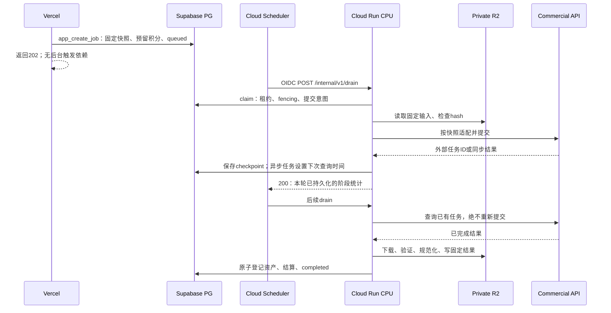

# Cloud Run 图像任务 Worker 设计

日期：2026-10-19。状态：**待人工架构评审，仅设计；没有实现 Worker、Worker SQL、容器或部署。** 本文补全 [接口协议 v1](../interfaces/INTERFACE_SPEC_V1.md) 第 6 节。公开协议以该文及 `packages/contracts/src/index.ts` 为准；下述内部 RPC 和数据库增量是后续开发提案，不表示当前数据库已提供。

## 1. 职责与设计结论

采用东京 `asia-northeast1` 的 Cloud Run **CPU Service**，通过需要 Google IAM 身份的 HTTP 请求推进 PG 持久任务。Cloud Scheduler 定期唤醒有界 drain；每次请求只推进能在预算内完成并落盘的阶段。异步供应商等待期间保存 `next_attempt_at` 后结束请求，下次调度再查，容器不常驻轮询。

Vercel 完成所有权/能力校验、Prompt 编译、不可变快照、任务和积分预留事务，返回 queued。**Web 不负责可靠触发，不发送 fire-and-forget 请求；Worker 独立扫描数据库。** 未上线 Worker 前继续保持生成开关关闭。可选 `process-job` 只是未来加速入口，丢失不影响恢复。

Worker 消费 `WorkerSnapshot`，执行 `commercial_edit / execution_version=1`，最多 4 张图，第一张唯一 primary，其余 role 为 subject/background/style/identity reference。每个 profile 仍可有更小张数和角色限制。20 个工具共享执行器；Worker 不重新读当前模板编 Prompt，不从工具名猜供应商参数。后续模型、多图、蒙版和 CPU 操作以版本扩展接入，首期不预建所有增强能力。

## 2. Google 平台约束与起始部署参数

以下平台事实已查官方资料；配置是本项目待压测的起点，不是吞吐/时延承诺。

| 平台事实 | 设计影响 |
|---|---|
| Cloud Run 请求默认 300 秒，最高 3600 秒；504 关闭连接但不保证容器停止 | 不能以 HTTP 断开作为停止或重新提交依据；应用 deadline、租约和 fencing 独立生效。[请求超时](https://docs.cloud.google.com/run/docs/configuring/request-timeout) |
| Cloud Scheduler HTTP deadline 默认 180 秒，可配 15–1800 秒；同一调度一般不会同时有两次未完成执行 | 必须显式配置两端超时；长同步请求会推迟后续调度，不能按一分钟周期推断排队延迟。[Scheduler Job 参考](https://docs.cloud.google.com/scheduler/docs/reference/rest/v1/projects.locations.jobs) |
| Scheduler 提供至少一次投递 | 重复唤醒是正常路径，任务领取与结算必须幂等。[Scheduler 概述](https://docs.cloud.google.com/scheduler/docs/overview) |
| 请求计费模式仅在处理请求时分配 CPU | 返回后不继续生成、下载或轮询；不以 min instances 替代持久队列。[计费与 CPU](https://docs.cloud.google.com/run/docs/configuring/billing-settings) |

建议起始参数：1 vCPU、2 GiB、min instances=0、max instances=2、每实例 HTTP concurrency=1、单请求阶段并行数=1、drain `limit=5`。内存压测需包含 4 张最大输入和图片解码；不能一次把 4 张 24M 像素展开进内存。串行读取/编码输入，必要时以受限临时文件传 multipart，临时盘同样计入内存占用。

同步提交起始 provider timeout=180s、drain 应用 deadline=200s、Cloud Run timeout=240s、lease=270s、Scheduler attempt deadline=300s。关系为 **外部阶段超时 + 持久化余量 < 应用 deadline < Run timeout < lease < Scheduler deadline**。DB/R2 请求各有更短独立超时，保留至少 15s 用于 checkpoint；实际配置校验必须拒绝不满足关系的组合。

drain `limit` 是最多推进阶段数，不是一次并行领取 10 个长任务。每次只领取当前执行槽能立即处理的任务；剩余预算不足该适配器阶段预算则停止领取。同步模型可能需要数分钟，不能用 40 秒通用上限误判为失败。若真实端点的 P95/最大请求超过当前预算，先延长整组预算（仍低于 Scheduler 上限），或选择真实支持异步任务/查询的接口；无恢复能力的超长同步端点不默认上线。异步 poll 常规单次 timeout 可从 10s 起测，不为了“等结果”延长请求。

Scheduler 起始每分钟触发一次，timezone=UTC，失败有限退避；drain 超时后仍以 PG 状态为准。同一调度执行受阻时同步生成可让轮询/排队等待数分钟，这是此简化方案的明确取舍。上线先测队列等待；若不满足产品时延，再引入独立受认证 dispatcher / Cloud Tasks 分派短阶段，保持现有任务协议不变。增大 max instances 不能单独解决单 Scheduler 唤醒的调度瓶颈。

## 3. 真实 IAM 与网络路径

1. 建立独立 runtime SA `image-worker-runtime` 与调用 SA `image-worker-scheduler`。Cloud Run 选择 **Require authentication**，不授予 `allUsers` 或浏览器调用权限。
2. Scheduler job 与 `image-worker-scheduler` SA 在同一项目；仅给该 SA 在目标 Cloud Run service 上的 `roles/run.invoker`。配置目标 `https://<service>.run.app/internal/v1/drain`、POST、JSON body、OIDC service account 为该 SA。
3. OIDC audience 显式设为服务的规范根 URL `https://<service>.run.app`，不带 `/internal/...`、query 或自定义推测域名；以部署实际 service URL 为准。Cloud Run 验证 Google ID token 和 IAM；不以请求自带邮箱头替代身份验证。[Scheduler 鉴权](https://docs.cloud.google.com/scheduler/docs/http-target-auth)、[Cloud Run service-to-service](https://docs.cloud.google.com/run/docs/authenticating/service-to-service)。
4. 保留 Google 管理的 Scheduler service agent 的 `roles/cloudscheduler.serviceAgent`；它为调用 SA 签发 token，不能把 service agent 误当调用 SA。部署/调度配置身份只在必要 SA 上拥有 `iam.serviceAccounts.actAs`。[官方调度示例](https://docs.cloud.google.com/run/docs/triggering/using-scheduler)。
5. runtime SA 只读本服务必要 Secret Manager secret versions：Supabase 服务凭证、Worker 专用 R2 bucket 凭证、供应商密钥。IAM 不会自动授权 Supabase/R2/商业端点；它们各自使用 TLS 和独立凭证。按协议，初期 RPC 仅 service_role 可调用；该凭证有绕过 RLS 的实际能力，Worker 必须避免通用表修改、记录并审计调用，不能声称仅靠 RPC 即物理隔离权限。未来收窄 DB 身份须独立迁移评审。
6. Vercel 不保存 Google SA 长期 JSON 私钥。将来启用 dispatcher，给其独立 SA 相同目标 service 的 invoker；使用平台身份/短期 ID token。CI 采用工作负载身份，不提交静态私钥。
7. 初期允许访问规范 Cloud Run URL 的网络入口，由 IAM 防护；不虚称 private network。若改为 internal ingress，必须另验同项目 Scheduler 及 ingress 要求后部署。外呼仅允许配置供应商、R2 和 Supabase 域名，TLS 校验开启。

`GET /health` 只返回 `{status:'ok',contract_version:'1.0.0'}`。应用无身份业务逻辑，但整个 Cloud Run IAM 仍拦截外部未认证访问；不会为健康探针开放生成路由。平台原生 startup/liveness probe 独立配置。

## 4. 内部 HTTP 协议

| 接口 | 请求与成功响应 | 行为 |
|---|---|---|
| POST `/internal/v1/drain` | `{contract_version:'1.0.0',limit?:1..20}`；200 `{contract_version:'1.0.0',request_id:UUID,processed:integer,remaining:boolean}` | limit默认5；processed为0..limit，只在阶段checkpoint持久化后计数；无任务正常200 |
| POST `/internal/v1/process-job` | `{contract_version:'1.0.0',job_id:UUID}`；200为同一ack，processed=0或1 | 预留加速接口，初期不接Web；相同claim算法，不能绕过预算/租约；leased/not_due/terminal/not_found均为processed=0 |
| GET `/health` | 无body；200 `{status:'ok',contract_version:'1.0.0'}` | 不披露密钥、供应商、队列和Prompt |

remaining是完成本轮时已知尚有due工作的提示，不是强一致队列长度；processing等待未来poll不因尚未终态就必须remaining=true。加速入口仅反映该job当前是否仍有due阶段。每轮claimed/deferred/failed/uncertain/cleanup_count/stopped_reason写内部日志，不扩冻结的HTTP响应。

认证失败由 Cloud Run IAM 返回401/403（平台响应不承诺业务ErrorEnvelope）；应用契约/JSON错误400，PG不可用等基础故障503，均用协议ErrorEnvelope；单个已持久化失败的 job 不把整个 drain 变成5xx。HTTP 200只证明本轮推进，不表示所有任务成功。统一 `X-Request-ID`、`X-Contract-Version`；内部错误也去除供应商响应、Prompt、图片和签名URL。请求 body 上限8KiB，拒绝额外字段。每轮设置 AbortController/deadline；收到 SIGTERM 或客户端断开后不再领新任务，尽力在现有剩余时间checkpoint，失败则等待租约恢复。

## 5. 持久状态、领取和 fencing

对外状态保留 `queued → processing → completed/failed`，queued 可取消。内部阶段与对外关系：

| stage | status | 允许的恢复动作 |
|---|---|---|
| queued | queued | 验证快照/资产、领取、固定提交意图 |
| submitting | processing | 已提交意图持久化；过期恢复先查同一 request key，不能当新请求提交 |
| waiting_provider | processing | 根据原 provider_job_id 查询；完成则记录结果来源 |
| storing | processing | 读取原结果来源，验证并保存；不再调用生成 |
| settling | processing | 核实已保存manifest，原子结算 |
| needs_reconciliation | processing | 仅查询/对账原 attempt；超恢复期限按失败释放 |
| done | completed/failed/cancelled | 不再执行；重复结果仅确认原终态或清理 |

**lease 是阶段执行占有权，不是外部任务的生命期。** waiting_provider 保存 checkpoint 后释放 lease，下次 due 再领；外部在途额度保留到已知终止或对账裁定。领取采用短 PG 事务、`FOR UPDATE SKIP LOCKED`，按到期时间/创建时间稳定排序；优先恢复 due 的 storing/settling 和 poll，再在受限比例内领取新 queued，防止新任务挤掉交付。

与现有Web锁序对齐：先不加行锁读取候选owner，然后尝试同一 `pg_try_advisory_xact_lock(hashtextextended(owner_id::text,0))`；失败跳过该owner，成功后才对该owner候选job使用SKIP LOCKED并重新检查状态。不能先锁job再等待owner advisory，否则会与现有cancel形成环。短RPC事务内不做网络IO；provider budget只在已锁job之后锁，所有Worker预算操作保持此顺序。清理需要读job/资产时也先拿所属owner advisory，避免图片锁/任务锁逆序。

每次领取：用 DB 当前时间检查过期，递增 `lease_version`、生成随机 `lease_token`，写 `lease_owner`/expiry。每次写回必须同时匹配 `(job_id,lease_token,lease_version)`、lease未过期、允许的stage/status。旧 Worker 即使晚到也不能完成、失败、扣费或覆盖新checkpoint；返回 `STALE_LEASE` 后立即停止业务写入。**fencing只能阻止数据库覆盖，不能撤销已经发给供应商的请求。** 提交去重靠持久 attempt/request key 和供应商能力，不能宣称恰好一次调用。

queued 领取与 `app_cancel_job` 使用同一job行锁；谁先提交谁生效。取消成功后Worker不再领取；领取先行则取消返回 JOB_NOT_CANCELLABLE。Worker不把 processing 退回 queued。应用预算内短阶段不需要常驻续租；若未来单阶段延长，必须同步重配整组时限或新增条件续租RPC，不能仅延长HTTP timeout。

## 6. 数据库增量提案（本轮不实现）

已对照实际 [Web migration](../../supabase/migrations/202610190001_web_backend.sql)：基础模型为 `public.edit_jobs(id,owner_id,inputs,snapshot,credits_reserved,status,stage,...)`、`job_inputs`、`images`、`credit_accounts`、`credit_ledger`。edit_jobs已有lease_token、lease_expires_at、attempt_count、provider_request_id、provider_job_id、checkpoint、updated_at，本节不重复创建这些字段，也不宣称现有migration已支持完整Worker。复用账户/账本和原子创建/取消规则，不建立第二套余额。

| 表 | 建议新增字段与约束 |
|---|---|
| edit_jobs | 新增 `lease_version bigint default 0`, `lease_owner text?`, `next_attempt_at timestamptz`, `current_attempt_id uuid?`, `recovery_deadline_at timestamptz`, `internal_error_code text?`；现有provider_request_id/provider_job_id/checkpoint为当前attempt的投影，job_attempts为完整事实，不维护两个互相竞争的权威；部分索引 `(next_attempt_at,created_at,id)` 仅非终态；终态结果/账务不可逆 |
| job_inputs | 复用image_id、role、position；在创建/claim记录所引用固定资产的hash/key等不可变元数据，或由image行不可变约束保障；不是把可过期签名URL写进快照 |
| images | 新增 `source_kind='upload'|'generated'`、`source_job_id uuid?`；generated结果没有客户端上传，当前NOT NULL的temp_key/declared_mime/declared_bytes须改为按source_kind条件约束：upload必须齐全，generated可空且source_job_id必须存在。保留ready图hash/尺寸/固定key约束；不得伪造上传记录补齐字段。结果ready与job完成同事务登记，删除不级联删除历史 |
| job_attempts（新增） | `id,job_id,attempt_no,provider,model_id,adapter_version,provider_request_key,provider_job_id?,state,submitted_at?,provider_result_ref?,result_expires_at?,poll_count,transport_retry_count,last_error_class?,estimated_cost_minor,cost_currency,actual_cost_minor?,created_at,updated_at`；unique(job_id,attempt_no)、unique(provider,provider_request_key)；敏感result ref不对用户SELECT |
| job_artifacts（新增） | `id,job_id,attempt_id,kind,storage_key,sha256,mime_type,bytes,width,height,state,created_at`；kind=provider_output/result/preview；unique(job_id,attempt_id,kind,sha256)，candidate→committed/tombstoned，提交后不能覆盖为其他内容 |
| provider_budgets（新增） | provider/account/window、币种、额度、reserved、committed、active_count、max_inflight、cooldown_until、enabled；行锁序列固定，预算预留必须在新提交前发生 |
| object_cleanup_tasks（新增） | key、来源job/image、原因、not_before、attempt_count、next_attempt_at、lease字段、state、last_error；唯一待删key；覆盖Web tombstone、过期输入/结果、未完成上传及孤儿artifact |
| 现有积分账本 | 沿用Web reserve/release约束；未来consume唯一键按job。一个job只能 reserve一次，consume或release至多且互斥；供应商成本独立记，不等于用户积分 |

`snapshot`不可修改；当前contracts没有资产key/hash字段，Worker通过受控claim返回关联资产manifest。`inputs jsonb`和`job_inputs`必须来自同一创建事务并一致，不能让Worker凭HTTP新传的输入替换。`provider_result_ref`为受控JSON（URL或外部asset ID），不能保存任意超大响应；外部URL含secret时按凭证数据保护。记录供应商成本证据来源/是否估计，不把猜测记成实际账单。

预算表采用整数最小货币单位及明确币种；无法逐任务精确得费时预留保守上限、终态对账释放差额，按供应商配置换算与取整，禁止把JPY积分直接当USD成本。claim恢复旧任务不重复预留提交预算。未知费用请求保留预算占用直到对账/平台损失确认，避免超预算却继续接单。

## 7. Worker RPC 详细合同

以下函数未来全部 `SECURITY DEFINER`、固定安全 search_path、显式撤销 public/anon/authenticated 的 execute，仅 service_role；动态SQL禁止。使用DB时间和行锁；返回内部typed JSON，不给浏览器。RPC共同写回参数为 `p_job_id uuid,p_lease_token uuid,p_lease_version bigint`；共同失败为 `STALE_LEASE/INVALID_TRANSITION/INVALID_CHECKPOINT`。Worker不信任RPC调用方传入的owner，始终由job反查。

内部JSON类型约定（仅设计数据字典，未增加运行代码）：

| 名称 | 完整字段/规则 |
|---|---|
| SupportedVersion | `{contract_version:string,execution_type:string,execution_version:positive_int,provider:string,adapter_version:string}`；p_supported_versions为1..50项数组，不含密钥 |
| InputAsset | `{image_id:UUID,role:InputRole,position:0..3,storage_key:string,sha256:64位hex,mime_type:'image/png',bytes:positive_int,width:positive_int,height:positive_int}`；顺序/角色与snapshot一致 |
| ResultRef | `{kind:'url'|'provider_asset',locator:string,provider:string}`；locator最大4096字符且按适配器允许域/格式验证，拒绝额外字段；TTL独立存储；bytes结果不能硬塞JSON |
| Artifact | `{kind:'provider_output'|'result'|'preview',storage_key:string,sha256:64位hex,mime_type:'image/png'|'image/jpeg'|'image/webp',bytes:positive_int,width:positive_int,height:positive_int}`；p_artifacts为1..3项，无重复kind；complete必须含PNG result及JPEG preview，provider_output可不提交 |
| Cost | `{currency:三位大写代码,amount_minor:nonnegative_int,evidence:'provider_report'|'invoice'|'estimate',provider_reference:string|null}`；null表示费用未知，不表示0；最多128字符reference |
| ProviderUsage | `{cost:Cost|null,output_count:nonnegative_int|null}`；不复制完整原始response |
| Attempt | `{attempt_id:UUID,attempt_no:positive_int,provider:string,model_id:string,adapter_version:string,provider_request_key:string,provider_job_id:string|null,state:'prepared'|'accepted'|'succeeded'|'failed'|'uncertain',submitted_at:UTC|null,result_ref:ResultRef|null,result_expires_at:UTC|null,poll_count:nonnegative_int,transport_retry_count:nonnegative_int,estimated_cost:Cost,actual_cost:Cost|null}` |
| Checkpoint | `{provider_state:'pending'|'succeeded'|'failed'|'unknown'|null,result_ref:ResultRef|null,result_expires_at:UTC|null,artifacts:Artifact[],poll_count:nonnegative_int,transport_retry_count:nonnegative_int,error_class:string|null}`；字段必须齐全，nullable明确，禁止新增任意供应商参数 |
| Evidence | `{provider_request_key:string,operation:'submit'|'lookup'|'fetch',started_at:UTC,observed_at:UTC,transport_phase:'before_send'|'body_sent_or_unknown'|'response_received',http_status:integer|null,reason_code:string}`；无header/body/图片数据 |

UTC为ISO8601；数据库时间为timestamptz，数字均有限整数；所有内部JSON严格拒绝额外字段且有64KiB总上限，单个key最大1024字符、普通reason最大128字符。下面返回的status/stage来自第5节枚举；applied:boolean、计数均非负整数。非终态写入默认必须持当前有效lease；只有complete/fail对匹配同一attempt及事实的已存在终态允许只读幂等返回。

record/defer/mark_uncertain响应丢失且lease已清除时，先读回checkpoint再恢复；RPC也可对**同一lease_version且所有已落盘事实完全一致**的重复请求只读返回applied=false。这是幂等确认，不授予新写权限。版本已前进或checkpoint内容不一致则STALE_LEASE，不能重放旧next_attempt_at覆盖新状态。

写回返回类型进一步固定：record/defer为 `{applied:boolean,status:'processing',stage:Stage,next_attempt_at:UTC|null}`；complete为 `{applied:boolean,status:'completed',result_image_id:UUID,credits_consumed:nonnegative_int}`；fail为 `{applied:boolean,status:'failed',credits_released:nonnegative_int}`；mark_uncertain为 `{applied:boolean,status:'processing',stage:'needs_reconciliation',recovery_deadline_at:UTC}`。处理恢复时不返回未定义的部分对象。所有RPC失败为PG稳定异常message code，适配层转内部业务错误，不把原SQL错误暴露HTTP。

### 7.1 worker_claim_jobs

参数：`p_worker_id text`（≤128）、`p_limit int`（1..20，实际为空闲执行槽）、`p_supported_versions SupportedVersion[]`（契约/execution/adapter允许组合）、`p_lease_seconds int default 270`（从运维允许范围验证）、`p_job_id uuid default null`（快速入口）。

返回：`{claims:[{job_id:UUID,owner_id:UUID,status:JobStatus,stage:Stage,lease_token:UUID,lease_version:positive_int,lease_expires_at:UTC,recovery_deadline_at:UTC,snapshot:WorkerSnapshot,input_assets:InputAsset[],attempt:Attempt|null,artifact_manifest:Artifact[],preflight_error:string|null}],skipped:{not_due:integer,leased:integer,terminal:integer,unsupported:integer,backpressure:integer}}`。不包含现成长期URL。

queued首次领取在**同一事务**检查资产仍ready/归属一致、未过期、账户允许执行、快照可支持、provider budget与inflight额度；新建 attempt、持久化 provider_request_key、占用成本预算，写 status=processing/stage=submitting，随后才可网络提交。能力不支持时不偷偷换模型，写可操作告警；配置错误不可永久静默跳过，应由维护流程终止释放。恢复 submitting只返原attempt，不能新建请求key。未 due 或已占有的指定job返回空claims及原因，不报“生成失败”。

遇到确定无效输入、账户受限或排队恢复期限已到的job，不无限skip：可领取为仅终止用途的claim，preflight_error=`ASSET_UNAVAILABLE/ACCOUNT_RESTRICTED/JOB_EXPIRED`、attempt=null（尚未提交时）、input_assets可为空，不占供应商预算；调用worker_fail_job释放。unsupported版本先告警并等待兼容部署，在恢复期限内只统计跳过；到期也可领只终止claim，preflight_error=UNSUPPORTED_SNAPSHOT，禁止执行快照。不因模型能力暂不可用无限占用户预留。

### 7.2 worker_record_submission

参数：共同参数 + `p_attempt_id uuid,p_provider_state text`（accepted/succeeded）、`p_provider_job_id text default null,p_result_ref ResultRef default null,p_result_expires_at timestamptz default null,p_next_attempt_at timestamptz default null,p_provider_usage ProviderUsage default null`。

返回：`{applied:boolean,status,stage,next_attempt_at}`。校验attempt归属与原request key；accepted必须有可查询ID及非null的next_attempt_at，写waiting_provider；succeeded必须有可恢复结果引用或已保存artifact manifest，写storing且next_attempt_at=DB now。同步二进制结果若没有可恢复引用，须在当前请求内先写候选R2并登记manifest，checkpoint通过7.3；这段崩溃窗口若既无结果又无法查询，进入不确定态，不能再生成。accepted记录/结果引用成功后清lease；重复相同值幂等，不允许替换成另一个provider job。provider_job_id不超过512字符。

### 7.3 worker_defer_job

参数：共同参数 + `p_attempt_id uuid,p_stage text,p_next_attempt_at timestamptz,p_checkpoint Checkpoint,p_reason text`（≤128）。

允许stage=waiting_provider/storing/settling/needs_reconciliation；checkpoint严格白名单：外部任务状态/结果来源、候选artifact manifest、poll/transport计数和稳定错误分类。拒绝改snapshot、费用、owner、provider request key。storing可记录已持久保存的原始输出或规范候选，settling必须有完整最终result/preview manifest。返回 `{applied,status,stage,next_attempt_at}`，保存checkpoint、清lease；供应商还在运行时保留inflight占用。外部操作前已固定意图但未获结果不能通过defer伪装回queued。

### 7.4 worker_complete_job

参数：共同参数 + `p_attempt_id uuid,p_artifacts Artifact[],p_cost Cost default null`；artifacts要求result+preview的key/hash/格式/字节/尺寸，且与登记manifest一致。

返回 `{applied:boolean,status:'completed',result_image_id,credits_consumed}`。同一PG事务使用与Web一致的owner advisory锁先行，再锁job、必要图片（UUID顺序）及credit account；不能在持有job锁后阻塞等owner advisory锁。确认仍processing、预留存在、非tombstone、结果所有者=job owner，登记generated结果图片ready、关联job及版本来源、消费预留积分、写唯一consume流水、stage=done/完成时间、释放provider inflight并核销已知成本预算。外部R2不在PG事务中，调用前已校验对象；任一步失败全回滚。相同attempt/manifest对已completed的重复请求允许先只读终态验证、返回applied=false和原结果，不要求已清除的lease仍存在，也不修改终态行；对failed/cancelled拒绝复活并安排独立候选清理。

### 7.5 worker_fail_job

参数：共同参数 + `p_error_code text,p_reason_class text,p_attempt_id uuid default null,p_cost Cost default null`。公开error_code只用审定白名单，raw provider error另存受限诊断，不透出给用户。

返回 `{applied:boolean,status:'failed',credits_released}`。只允许确定不可恢复失败或已到 recovery deadline 的裁定；PG事务终结、释放尚未消费的预留、唯一release流水、处理provider预算/损失、释放inflight、候选清理入队。已完成返回冲突，不退款；相同失败重放applied=false。供应商运行状态未知时不能谎记取消或费用0；到期释放给用户后平台承担已发生/晚到成本。

### 7.6 worker_mark_uncertain

参数：共同参数 + `p_attempt_id uuid,p_reason text,p_next_attempt_at timestamptz,p_evidence Evidence`（request key、HTTP阶段/时间、可查询证据；无密钥正文）。

返回 `{applied,status:'processing',stage:'needs_reconciliation',recovery_deadline_at}`。保存证据、清lease、保留用户积分预留和provider预算。claim后只允许原request key查询、可证明同一请求的幂等重放、对账或到期失败；不能自动新建attempt。没有自动查询能力则告警人工evaluation/运营核对，并设置有界到期释放，不能让用户无限等待。

### 7.7 清理增补 RPC（私有提案）

六个任务RPC之外，还需要 `worker_claim_cleanup(p_worker_id,p_limit,p_lease_seconds)`、`worker_finish_cleanup(p_task_id,p_lease_token,p_outcome,p_next_attempt_at?,p_error_class?)`，以及 `worker_enqueue_expired_assets(p_limit)`。它们仅供同一drain内部维护阶段调用，不改变公开HTTP合同。enqueue以图片行锁检查无queued/processing引用再tombstone并写cleanup；有活跃引用则延后，超过作业恢复期限先终止任务再清理。claim返回准确key及原因；finish只接受deleted/not_found/retry，404等价删除成功。任何清理不能根据key前缀推断是否有归属。

清理RPC类型：claim参数worker_id:string≤128、limit:1..100、lease_seconds:positive_int允许配置范围内，返回 `{tasks:[{task_id:UUID,storage_key:string,reason:string,lease_token:UUID,lease_expires_at:UTC,attempt_count:integer}]}`；finish的task_id/token为UUID，outcome=`deleted/not_found/retry`，next_attempt_at为UTC|null（retry必填），error_class为string|null，返回 `{applied:boolean,state:'done'|'pending',next_attempt_at:UTC|null}`；已done同token/事实返回applied=false，不改终态。enqueue参数limit:1..100，返回 `{tombstoned:integer,enqueued:integer,deferred_active:integer}`。过期清理不能直接改edit_jobs终态，须走持lease的fail流程。

## 8. 商业模型适配与不确定提交

每个适配器版本提供以下有限职责，不建立任意可编排工作流：

| 方法 | 输入/返回 |
|---|---|
| validate | snapshot+输入manifest → 能力/格式/输出支持结论；不改用户意图 |
| submit | 固定final_prompt、有序role/图、output、稳定provider_request_key → accepted(provider_job_id) / succeeded(result locator或bytes) / 明确拒绝 / uncertain |
| lookup | 原request key或provider_job_id → pending/succeeded/failed/not_found/unknown；not_found的最终语义由供应商实测确认 |
| fetchResult | 受限结果来源 → 有字节上限/超时的流，不接受用户URL |
| classifyError | 供应商错误 → permanent/retryable_before_acceptance/uncertain/throttled；不由HTTP状态单独猜收费事实 |

部署前为所选真实端点记录：精确API/模型、鉴权、同步/异步、multi-image/role映射、幂等key作用域与有效期、查请求能力、结果有效期、计费和错误语义。**在未拿到这些证据前，不编造中转商接口或费用。** 供应商只接收图片数组但不理解role时，适配器可按已验证规则构造有序说明；无法保证目标能力则禁用该profile/工具组合。

端点registry按 `(provider,adapter_version)` 固定base URL、API路径、协议/错误映射和credential secret reference；密钥可轮换，不能把同一adapter_version的供应商地址/语义默默替换。snapshot的精确model_id与profile_id参与审计；旧版本registry缺失时阻止执行并告警，不能落到当前默认端点。注册信息不接受来自用户请求的URL。

提交前：输入已校验、request key和成本预算已PG落盘。网络结果按下表处理：

| 情况 | 后续动作 |
|---|---|
| 能证明没有发出请求（本地校验失败、发送前建立连接失败且客户端库能证明） | 可在同一request key下有限退避；非幂等端点仍保守处理 |
| 收到供应商明确未受理的限流/错误 | 按真实文档/测试分类；Retry-After入PG，不在内存睡眠 |
| 请求body可能已发出，读超时/连接中断/Worker崩溃 | needs_reconciliation；先lookup；不能仅因未拿到ID就重试 |
| 支持可靠幂等重放且仍在有效期内 | 复用相同key和完全相同请求；确认不会生成第二次后才重放 |
| 查询返回not_found但索引可能延迟 | 仍不确定；等待一致性窗口，不能把一次404当未收费证明 |
| 无查询/幂等能力的同步请求响应丢失 | 禁止自动重生成；人工查账或到期失败释放，平台承担损失 |

同步二进制在接收与R2持久化间无法跨进程恢复，属于明确风险。优先使用可恢复结果引用；否则在单次预算内流式落候选对象、校验后登记。崩溃发生在provider受理到首次可恢复checkpoint之间时采用上面的保守不确定策略。供应商声称支持Idempotency-Key也要实测有效期和重复计费行为。

异步poll每次只查一次并持久化 `next_attempt_at`。起始指数退避5/10/20/40/60s并加全抖动，尊重供应商Retry-After；一分钟Scheduler会使实际查询更慢，不承诺5s轮询。poll次数与生成attempt次数分开。瞬时PG/R2失败有限重试，阶段保存失败只重试保存。到期策略应覆盖供应商正常最长耗时和结果TTL；建议初始恢复期限30分钟、结果保存重试不超过结果有效期，是待实测配置，不是供应商事实或用户SLA。

## 9. R2 输入、结果校验与原子交付

输入来自claim返回的固定规范图key，禁止用暂存PUT键。读取前重新核对图片owner、ready和hash；对同一已领取任务，删除/过期清理由行锁和运行中引用保护，不能中途悄悄替换输入。

Worker可用其bucket凭证直接GetObject；供应商支持multipart时优先传字节，支持URL时按具体固定key签只读GET，起始TTL5分钟须覆盖供应商真实取图延迟并在有效期内再提交。签名不落普通日志、不写长期快照。R2签名在到期前可重复使用，因此不能称为一次性读取；预签名仅授予对应对象/操作。[R2预签名文档](https://developers.cloudflare.com/r2/api/s3/presigned-urls/)。异步供应商延迟拉图需要更长TTL或供应商受理后立即取图的实测证据，不能默认5分钟总足够。

结果来源仅允许适配器配置的HTTPS域名/外部asset ID；下载前防SSRF、拒绝回环/私网/metadata目标，禁自动跟随不受控redirect，每跳重新验证；不接受用户提供的任意URL。连接/读取/总时限分开，流读取上限32MiB；不因Content-Length缺失取消限额。校验文件头、真实解码、单帧、尺寸和像素上限（起始24M，profile更小取更小），防解压炸弹，验证所选输出比例与上游约束。

规范化EXIF方向、sRGB、剔除位置元数据；结果保存PNG（规范结果≤32MiB），预览JPEG最长边768/≤1MiB，与Web媒体规则一致。语义质量差不自动当技术失败或无限重抽；评价/重做政策独立决定，不在此Worker偷偷增加费用。

候选key采用 `results/<owner>/<job>/<attempt>/<sha256>.png` 与对应preview，hash寻址保证相同重试幂等，永不覆盖另一hash内容；写后读取元数据/必要字节验证，保存artifact manifest。并发旧Worker上传的未登记对象可能存在，不能据此认定已交付；下一阶段PG事务只接受当前fencing的合法manifest。对象读取成功不证明PG已结算，PG completed才是用户可见完成。

R2写成功但PG响应丢失：查询原job。已completed且manifest一致直接完成；仍processing则重新claim后复用原对象和原manifest结算；已failed/cancelled则清理对象，不复活或补扣。结果URL过期但还有provider job查询能力时重新获取相同结果；无法恢复时失败释放并记录平台损失，不能新生成替换。

## 10. 取消、删除、过期与晚到结果

- queued取消只由Web原子RPC释放积分；Worker不另做补偿。processing不承诺可撤销，未来供应商cancel可作为增量能力，不改变已发生费用事实。
- Web删除先tombstone、后删对象；运行中输入返回IMAGE_IN_USE。Worker完成事务、删除事务、过期清理使用兼容行锁顺序；删除先成功则不能再引用该图建新job，建job先成功则删除拒绝/延后。
- 时间到期也适用引用保护。新建job时拒绝过期输入；已创建活跃job的输入保留到任务终态/恢复期限，清理不能只看expires_at。结果保留期从生成时间计算，PG completed不会引用已经过期/删除结果。
- completed之后用户删除结果，任务历史仍可保留result_image_id但图片读取返回不可用；结果不能被Worker重新上传恢复。后续继续编辑必须重新通过ready/expiry检查。
- failed/已释放后晚到结果不自动变completed、不补扣、不重新发图；按job终态清理，并对供应商已花费用记平台损失。

维护在drain的独立小预算内推进，每轮上限配置，不因大批清理饿死生成。覆盖过期暂存、Web cleanup_pending、过期ready图、未提交artifact、残留multipart、临时文件。tombstone后每个key删除可重复；失败指数退避并告警。原图/预览/结果逐个确认，不把“清了一个key”标为整张图清完。

孤儿候选以job/attempt索引和object_inventory扫描对照，宽限期至少大于最大lease与结果保存恢复窗口；清理前PG再查无活跃/committed引用。若对象写入成功而PG完全无记录，仅依赖表内队列无法发现，必须有定期受限R2列举对账；不要为规范结果配置会无视运行中引用的盲目bucket过期规则。可对纯暂存前缀单独设生命周期作为兜底。

## 11. 费用、流控与观测

Cloud Run max instances只是基础资源保护，供应商并发和日预算以PG全局账户级预算为准；多个实例不能各自享有完整供应商额度。新submit前行锁预留一个inflight槽及保守成本；waiting_provider继续占用，poll不占新生成槽。对账不确定任务达到供应商风险上限时暂停新submit、继续poll/保存/结算/清理，避免“全局暂停”阻断已付成本交付。

job失败释放用户积分，与供应商成本预算核销是两套事实；费用未知时将预算转为待对账负债，不立即当节省额度重新消费。后续账单修正只写job_attempts/成本账，不修改Web migration已禁止变更的终态edit_jobs，不触发补扣或重新生成。账户在执行中变restricted时，既有预留任务仍按已发生提交事实交付/失败结算；只限制新提交，不让已花成本的结果永久卡住。

配置每用户活跃job上限、供应商并发/分钟请求/日成本上限、模型路由熔断、queued最长等待；Web已有持久频控与余额预留，Worker二次执行控制防积压。预算不足时job暂缓而非不断失败重排；超过用户允许等待期限后失败释放。429更新全局cooldown，避免所有实例同时重试。真实币种费率/额度需在部署时填入，不默认赠送无限调用。

Cloud资源预算告警与平台支持的支出控制应单独配置，并验证停服后的恢复；它们不能替代商业API的PG预提交预算。费用报表分Cloud Run、网络、R2、供应商及平台损失，按实际账单对账。

记录 `queue_wait_ms,stage_ms,provider_ms,store_ms,settle_ms,lease_expired_count,stale_write_count,uncertain_count,recovery_age,poll_count,provider_429,cleanup_backlog,cost_reserved,cost_actual,cost_unknown`，按tool/profile/adapter版本聚合。日志含request/job/attempt/version，不含原图、base64、Prompt全文、签名URL、服务密钥或未过滤供应商响应。对“最老queued”“最老不确定”“未结算已保存artifact”“预留账务不一致”“Scheduler失败”设置告警；数字阈值用staging基线校准。

## 12. 故障逐阶段恢复表

| 故障时点 | 权威证据 | 恢复动作与费用结果 |
|---|---|---|
| Web已queued，Scheduler未触发 | PG queued | 下一调度扫描；浏览器关闭无影响；仍预留 |
| Scheduler重投/两个实例同领 | PG lease/version | 一个获锁，一个跳过；无重复submit |
| 输入缺失/hash错误 | 固定manifest/R2 | 不提交；确定失败释放，记录资产故障 |
| claim后、网络发送前崩溃 | submitting+持久request key | 无跨进程“未发送”证明时仍先lookup；不假定安全重试 |
| provider受理，record_submission前崩溃 | attempt key、供应商查询 | 查原请求；无查/幂等则不确定并有界释放 |
| 同步调用超过预算/连接断开 | submitting、连接阶段 | uncertain；不把504等同未收费；旧Worker仍受fencing限制 |
| 异步pending容器重启 | provider_job_id/next_attempt_at | 下次只poll；不占CPU等候，不再生成 |
| 查询429/暂时5xx | 原provider ID、错误分类 | 全局退避/熔断；继续保留任务与预算 |
| 供应商明确失败 | provider终态 | fail事务释放积分；供应商成本按实际保留 |
| 结果下载中断/URL过期 | result ref、TTL | 重下原结果/lookup换同结果URL；不可恢复则释放并记损失 |
| R2只写了result，未写preview | candidate manifest/对象hash | 补预览并核验；不生成新图 |
| R2写后PG断线 | PG终态+artifact keys | 查权威状态、重入原settle；避免二次consume |
| settle事务中断或响应丢失 | 唯一ledger/job终态 | 原子回滚或已完成；重放复用原结果与费用 |
| lease过期后旧Worker返回 | version/token | 拒绝旧写；未引用对象清理；不再扣费 |
| queued取消和claim同时发生 | 同一job锁 | 取消赢则不提交；claim赢则明确不可取消 |
| 输入删除/过期与建job并发 | 图片行锁/job_inputs | 互斥检查；运行中引用受保护，不能断链 |
| 用户删了完成结果，旧Worker重放 | tombstone/job终态 | 不恢复图片，不重复扣费；清理晚到对象 |
| recovery deadline到期后收到结果 | failed+release流水 | 不复活/补扣；清理、平台损失对账 |
| R2清理失败/Worker停机 | cleanup_tasks | tombstone继续阻断访问，后续重试删除 |
| 新revision不支持旧adapter | snapshot版本矩阵 | 不改模型、不重计价；保留兼容revision或显式失败释放 |
| 全服务预算/供应商熔断 | PG budget与告警 | 阻止新submit，恢复已有结果优先；排队到期释放 |

## 13. 模型与执行版本迭代

Worker启动声明支持 `(contract_version,execution_type,execution_version,provider,adapter_version)` 组合，只claim能执行的快照。适配器发布与Web新profile启用分开：先部署兼容新旧版本的Worker并运行契约回归，再对小范围新job启用新profile；回滚只改新任务默认，旧job继续按原快照处理。profile指向的真实供应商不可锁版时记录可复现性限制，不虚称内部版本能固定上游行为。

同类模型替换只增加adapter/profile映射；新增工具复用既有执行能力时增加工具和模板版本，不新建20个服务。新蒙版/CPU操作需扩合同次/主版本、资产类型和执行版本；旧job不自动走新处理。历史Prompt/profile/计价在原job保留，Worker不因模板更新重新编译。供应商退役时先禁止新任务；已有job按原能力恢复或明确失败，不静默换模型产生新费用。

## 14. 上线步骤与人工验收

本轮只提交设计供审阅。后续实施按以下顺序，先人工确认架构和evaluation标准，再让AI编码：

1. **真实端点探查**：单图、多图角色、同步最长耗时、异步查询、幂等/404一致性窗口、URL拉取、输出/成本/结果TTL形成记录。至少验证一种单图和multi_photo_composite的真实请求，不用Mock替代供应商能力证据。
2. **数据库增量评审**：对照实际Web migration统一字段、锁顺序、积分唯一键；六任务RPC/清理RPC并发回归，检查最小权限，禁止浏览器写任务/余额。
3. **Worker实现与staging**：实现阶段执行、deadline/lease、adapter、媒体、恢复和清理；模拟供应商可测试故障，不连生产扣费。部署东京受认证service、Secret Manager、Scheduler，证明匿名失败、正确SA成功、错误aud/SA失败。
4. **可靠性演练**：每个第12节故障至少有可重复自动测试或明确真实演练证据；双实例争抢、kill-after-submit、R2成功PG失败、旧租约返回、取消/删除/过期竞态、超时未知、退款/账户限制下在途任务。断言一次消费/释放、无负余额、无跨用户读、无终态复活。
5. **版本演练**：旧job挂起，更新模板/模型默认，恢复时仍用旧快照；不支持版本不能静默新生成；新adapter回滚后旧任务可恢复。
6. **实际预算验证**：一组授权小额真实调用验证下载/持久结果/积分结算与账单；测4图内存峰值、同步两分钟请求、冷启动、队列等待、supplier429和预算闸门。资源参数和队列SLO按结果调整。
7. **20工具接入评估**：每工具至少有输入/参数/profile证据和限制；300初测任务用于覆盖，效果成熟度由人工evaluation判断，不把高难效果精修作为底座上线前置。技术交付与内容质量分别记录。
8. **受控启用**：先部署Worker和调度，确认空队列/告警/清理；再小额启用Web生成。停止新生成时继续恢复在途任务。回滚前检查旧snapshot兼容和最老预留；不删除队列表或账本。

待人工重点审阅：PG+Scheduler的初期队列时延取舍；同步无幂等供应商的损失容忍与恢复期限；profile成本上限；Worker增量RPC权限；输入保留/清理文案；真实供应商能力与预算。没有这些外部证据时仍可开发隔离的Worker，但不能声称已提供商用生成服务。
