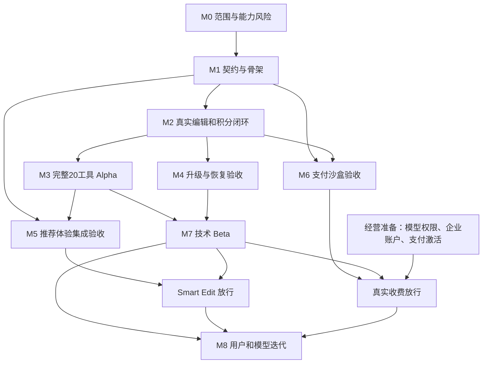

# 开发优先级、模块与 Milestone 草案

日期：2026-10-19。依据：[统一需求基线](../product/BASELINE_REQUIREMENTS.md)、[20 工具架构评审](../architecture/ARCHITECTURE_REVIEW_20_TOOLS.md)。状态：**整体里程碑仍为规划；本轮已实现 Vercel Web 后端并补全接口，Worker/JEV 仅设计，未部署云服务。生成闭环尚未完成，不能据此将 M2 或后续里程碑标为完成。** 实际交付见 [后端说明](../backend/VERCEL_BACKEND.md)。

## 1. 规划结论

**已确认的开发方式：全部由 AI 开发，多个 AI agent 按依赖并行；人工只负责架构设计和 evaluation。** 本文的模块责任均指 AI 责任，人工不是常规开发、合并或缺陷修复资源。详细分工、并发波次和评审点见 [AI_AGENT_EXECUTION_PLAN.md](AI_AGENT_EXECUTION_PLAN.md)。

建议按三条线组织开发：

1. **产品与执行主线**：真实模型能力确认 → 稳定契约和版本 → 上传/任务/积分闭环 → 20 工具共享体验 → 可恢复与可升级 → 受控 Beta。
2. **并行配套线**：JEV 推荐、日语内容、支付沙盒、质量评测和经营准备。它们各有明确交付，避免把单一服务或外部审核变成全部研发的等待点。
3. **持续改进线**：按真实效果、使用量和成本优化模板/模型，必要时再增加局部控制或专项处理。

20 个效果全部纳入初期需求、配置、接入及评测计划，**不是长期上限，也不要求首版达到最终精度**。先做少量代表链路，是验证公共底座的方法，不能代替完整 20 工具的设计与接入。

规划优先保证“结果能交付、扣费正确、模型能替换”。效果质量可以分等级迭代；照片归属、余额事务和失败恢复不能靠后期补救。

## 2. 优先级怎么判断

目前没有真实使用量、转化或工时统计，不虚构 RICE 分数。采用业务影响、依赖解锁范围、返工成本、外部不确定性四个维度定性排序。

| 优先级 | 含义 | 本项目适用范围 |
|---|---|---|
| P0：先解决 | 会决定架构是否可行，或是共享底座/数据资金正确性的前提 | 真端点与多图验证、契约、模型适配边界、身份与资产、持久任务、积分、版本、基础观测 |
| P1：首期完整体验 | 需要在首期产品中形成可用体验，但不必等它完成才验证底层链路 | 20 工具配置和页面、结果/历史/继续编辑、JEV、日语帮助、支付沙盒与积分包、发布准备 |
| P2：按证据增强 | 有明确质量/成本/转化问题后投入 | 精细区域控制、分割合成、专项处理、CPU 调色增强、推荐质量和价格优化 |
| P3：规模触发 | 数据量、吞吐或业务形态出现实际需求时再评估 | 复杂队列/路由、检索平台、订阅等级、批处理、团队协作等 |

P1 不等于可随意删掉；它表示完成顺序和依赖不同。P2 控制能力也仍在架构论证中，只是不预先全部实现。

### 最先推进的五件事

| 顺位 | 工作 | 为什么优先 | 避免的返工 |
|---|---|---|---|
| 1 | 验证真实编辑端点，尤其是多参考图、成本及不确定请求处理 | 能力不存在时，页面与接口再完整也不能交付 | 单图接口固化后再重做多图、错误采购和失控费用 |
| 2 | 明确工具、模板、模型适配和任务快照的边界 | 决定以后换模型、加参数、加效果的代价 | 供应商字段散布到前端、模型切换牵动支付与历史 |
| 3 | 做身份—固定资产—持久任务—积分的最小可靠闭环 | 所有工具共用，直接影响信任和运行成本 | 结果丢失、越权、重复提交和重复扣费 |
| 4 | 用共享工作台接入完整 20 工具 | 把已有底座变成产品，并暴露不同工具的真实短板 | 做 20 套独立页面逻辑，或只接入少量简单效果 |
| 5 | 提前演练模型切换、任务恢复和回滚 | 将“可迭代”从口头目标变成有证据的能力 | 等新模型发布时才发现旧任务和计费无法兼容 |

JEV 的可用模型/许可证/性能探查应早做；完整推荐体验可以并行实现，不需要挡在第一条编辑链路之前。Stripe 开户和银行准备也应立即启动，但测试开发不等外部审核。

## 3. 模块拆分和边界

目录为建议的责任划分，不表示这些目录或实现当前已经存在。角色均由 AI 承担，同一 agent 可在不同波次承担不同职责；人工负责架构决策和 evaluation，不承担表中的常规实现。模块与 agent 的对应及文件所有权见 AI 并行执行计划。

| 模块 | 优先级 | 职责与首期交付 | 主要依赖 | 开始/形成可用版本 | 建议责任边界 |
|---|---|---|---|---|---|
| D01 契约与工具能力目录 | P0 | 稳定 Tool ID；输入角色/数量、当前参数、输出、能力状态、错误与版本规范 | 20 工具需求、端点探查 | M0 / M1 | 集成负责人；`packages/contracts`、`packages/tool-config` |
| D02 模型接入与能力适配 | P0 | 真端点提交/查询/取结果；能力与限制、错误归一、成本；模型可配置替换 | API 权限及 D01 | M0 / M2，M4 验证升级 | Worker/模型负责人；`apps/worker` 的适配模块 |
| D03 身份、图片和存储 | P0 | Supabase 身份、用户归属；暂存直传、规范图固定版本、尺寸/格式校验、下载授权及删除 | 云环境、D01 | M1 / M2 | Auth/资产负责人；Web 上传 API、R2、相关 migrations |
| D04 持久任务与恢复调度 | P0 | 创建/领取、状态查询、超时、lease、补触发、结果保存；上游不确定态处置 | D02、D03、PG | M1 / M2，M4 恢复验收 | Worker/数据负责人；`apps/worker`、任务相关 migrations |
| D05 积分与费用记录 | P0 | 预留/结算/释放、追加式账本、幂等、并发、每次实际成本 | 身份、任务事务 | M1 / M2，M4 正确性验收 | DB/Billing 负责人；PG 受控函数与账务数据 |
| D06 Prompt 与效果配置 | P0 | 20 工具映射、初期模板、推荐资料、模型适用性、版本与已知限制 | D01、D02 | M0 / M3 | 产品/Prompt 负责人；`packages/prompts` |
| D07 日语共享工作台 | P1 | 单图/多图上传、效果选项、费用、状态、比较、下载、失败恢复；20 工具共用 | D01，可先用契约 Mock | M1 / M3 | Web 负责人；`apps/web` |
| D08 历史与继续编辑 | P1 | 主图/多来源关系、结果列表、当前图继续编辑、删除规则；不做复杂画布 | D03、D04、D07 | M2 / M3 | Web + 资产负责人，共用既有任务接口 |
| D09 JEV 推荐与 Smart Edit | P1 | 图像与候选资料评分；输入前置条件、有效候选过滤、推荐卡片和回退 | JEV 可用权重/环境、D01/D06/D07 | M0 探查、M1 可独立实现 / M5 | JEV 负责人；`apps/jev-service`；Web 负责产品呈现 |
| D10 订单、积分包与 Stripe | P1 | 服务端套餐、Checkout、签名 Webhook、幂等充值、退款/对账基本路径 | D03/D05；正式收费另依赖外部激活 | M1 沙盒设计 / M6 | Billing 负责人；Web 支付 API、订单 migrations |
| D11 评测、埋点和反馈 | P0 | 授权样本、逐工具结果记录、费用/时延/失败、用户反馈、版本对比 | 贯穿 D01–D10 | M0 / 每个 milestone | QA/产品负责人；`benchmarks`、事件字典与报告 |
| D12 环境、发布与运行维护 | P0 | 开发/staging/生产隔离、密钥、部署、恢复入口、日志、生成开关、费用上限、回滚 | 云账号与部署权限 | M1 / M2；M7 发布验收 | 集成/运维负责人；CI、云配置、运行手册 |
| D13 日语内容与早期增长 | P1 | 20 工具内容结构、真实例图、帮助与价格说明、基本 SEO、渠道归因 | D06、真实结果；页面可先排版 | M0 研究 / M3 内容，M7 实验 | 产品/日语/Growth 负责人 |
| D14 按需效果增强 | P2 | CPU 调色、额外参考图、局部区域/分割合成或专项端点 | 质量证据、模型成本和用户需求 | M8；必要的小改可提前评审 | 对应 Worker/Prompt/Web 责任人 |

D03 与 D08 共用资产模型，D04 与 D05 共享原子事务；这是需共同设计的边界，不应各自独立定义一套状态。D01 接口改动由集成责任人统一，避免多个模块同时修改协议造成反复返工。

## 4. Milestone 总览

| Milestone | 阶段成果 | 核心问题 | 退出证据 |
|---|---|---|---|
| M0 范围与能力风险收敛 | 知道初期如何接入、哪里未知 | 模型真实可用吗？多图如何做？哪些事实会改变设计？ | 20 工具能力矩阵、关键真调用记录、约束和未决事项 |
| M1 稳定边界与项目骨架 | 各模块能按同一规范开发 | 如何把工具、模型与任务分开？ | 核心契约、数据/状态设计、Mock、环境与责任边界 |
| M2 真实最小闭环 | 用户可可靠取得一张真实编辑结果 | 上传、执行、交付和积分能否闭合？ | 单图/多图代表场景的真实链路和账务记录 |
| M3 完整 20 工具 Alpha | 初期目录成为可操作产品 | 共用底座能否表达全部效果？ | 20 工具接入状态、工作台、历史、继续编辑及逐工具证据 |
| M4 模型演进与恢复验收 | 可以升级而不破坏旧任务 | 新模型、新参数与异常会不会牵动整站？ | 切换/回滚、兼容、并发与恢复报告 |
| M5 Smart Edit 推荐体验 | 没有明确目标的用户也能选到效果 | 推荐是否相关且可执行？ | 真实 JEV 推荐、候选过滤、选择到生成与回退记录 |
| M6 交易闭环就绪 | 价格、订单、充值与消费可核对 | 真实成本下能否合理收费？ | Stripe 沙盒全链路、套餐核算、订单账本与退款测试 |
| M7 受控 Beta 与首轮验证 | 有真实使用证据并可安全运营 | 用户能否理解、完成并愿意再用/付费？ | 发布验收、用户反馈、漏斗/费用记录；实际收款单独放行 |
| M8 持续模型与效果迭代 | 有节奏地改善用户价值与单位成本 | 下一笔投入该改模型、模板还是体验？ | 每轮版本对照、用户结果和继续/停止决策 |

M0–M7 是首期研发/发布节点，M8 是长期工作方式。不能把 M8 的所有增强内容提前塞回首版。

## 5. 每个 Milestone 的具体交付与验收

### M0：范围与能力风险收敛

**目标：让接下来的设计建立在真实端点和明确边界上。**

- D01/D06：完整 20 工具的初期输入、参数、效果边界、模板与端点能力映射；明确哪些是已知支持、待验证或当前不支持。
- D02：至少一个真实编辑端点可访问；重点验证单图编辑、多参考图、返回格式、任务查询/超时和费用记录。多图能力探查放在最早，不等最后一个工具才发现问题。
- D11：建立少量授权探查样本及结果格式。优先覆盖风格转换、目标删除、局部改色/人像保真、多图组合等能力差异，不要求先完成 300 次评测。
- D09：确认 JEV 具体模型来源、许可证、运行环境与基本调用方法；发现阻塞独立登记。
- 经营准备线：列出模型授权、云/API 访问权限、香港账户与支付激活的材料/责任人；只跟踪状态，不把未完成事项写成已具备。

验收：每项关键能力都有证据或明确未知项；不能因为所有请求都能返回图片就认定 20 效果质量通过。若缺少 API 权限，可继续 Mock 和协议工作，但 M0 的真实供应商验证部分不标完成。

### M1：稳定边界与项目骨架

**目标：后续各模块能接同一套协议，模型替换不会散落到页面和账务。**

- 固定工具 ID、单图/多图角色集合、当前参数规则、标准错误与对外任务状态。
- 明确工具配置、Prompt/参数策略、模型能力/适配器、任务/计价快照各自版本；先支持已知接口，不设计万能模型平台。
- 明确规范图片、任务输入关系、结果版本、积分/订单与幂等作用域。
- 定义首次触发和独立扫描恢复机制、上游不确定请求处理、删除与取消的边界。
- 建立项目目录、环境变量清单、Mock、staging 最小部署、日志关联 ID 和基本 CI。
- Web 以 Mock 做共享流程；JEV、Prompt、支付沙盒按冻结的核心字段独立推进。

验收：20 工具的初期需求都可表达；不会为了第二张图就改余额主模型；第三方专有参数留在适配层。冻结的是当前核心边界，不是禁止后续新增可选能力。

### M2：真实最小闭环

**目标：把可靠交付的公共底座真正跑通。**

- 最低限度真实登录/测试身份；无须先做完所有登录渠道，但图片必须有确定归属。
- 原图暂存直传、服务端固定规范版本与校验；私有预览和下载授权。
- 创建任务与积分预留同事务；Worker 领取，调用真实端点，结果落 R2，登记并结算。
- 状态查询、失败释放、触发失败后的独立补触发、调用成本和时延可追踪。
- 用代表性单图任务和真实多图任务跑通输入、所有权、提交和结果交付。测试积分由可审计方式发放，不依赖正式收款。

验收：刷新/离开页面后任务仍存在，失败不重复扣积分；结果已保存才显示完成。多图端点若仍未就绪，单图闭环可验收为部分成果，但不能宣称完整多图闭环完成，也不能把两图先拼成一图当作等价证明。

这一节点只验证公共链路，不是回退到少量工具的产品范围。

### M3：完整 20 工具 Alpha

**目标：共享工作台表达全部 20 个初期效果，形成可内部试用的产品。**

- 20 个工具均有配置、模板/描述、输入限制、积分/费用规则、状态和初期样例。
- 共用上传、单图/多图配置、生成、比较、下载与错误恢复组件；仅显示当前端点真实支持的参数。
- 结果列表、当前图继续编辑、主图/参考图来源关系和删除基础流程。
- 每工具至少保存真实调用的结果、费用和已知限制；“未接通/待验证/内部试验/可邀请试用”状态分别记录，Mock 不计作真实接入。
- 逐步积累统一 300 任务样本，不把所有效果精修到最终质量作为 Alpha 前提。
- 20 工具的日语独立内容、FAQ 和样例结构完成；正式例图使用真实且有权展示的结果。

验收：配置和工作台覆盖 20/20；逐工具真实接入证据与质量状态可查。存在能力阻塞的条目必须列出，不能把“有入口”当作接入完成；可保留部分成果，但完整 20 接入项不标全部完成。效果可先处于内部试验等级，不能以此强制追加分割或蒙版工程。

### M4：模型演进与恢复验收

**目标：证明后续升级是局部变化，异常不会损坏资产或资金。**

- 配置一个候选模型/适配版本，用固定输入比较费用和效果；新默认只影响新任务，能回滚。
- 原模型/旧模板的在途任务继续使用快照，或在上游版本失效时进入明确可解释的失败/迁移处理。
- 验证新增可选参数、新参考图能力的接入，不改登录/订单/积分主流程；可用测试配置演练新增效果，不改变对外 20 工具范围。
- 余额并发、幂等键冲突、重复触发、lease 过期旧 Worker 写回、上游响应丢失、结果保存/结算失败和删除竞态。
- 生成开关、单工具禁用、供应商限流、费用熔断与任务人工处置有入口。

验收分开报告：替代适配器 Mock 可证明结构兼容和错误处理；只有第二个真实端点/版本调用才能证明真实模型切换。缺少第二端点时如实标注验证范围，不要求为了形式上有两个模型延误已有单端点产品，但不能声称实际切换已经验证。

此节点可在 M2 后开始，随 M3 接入逐项补完；不必等 20 工具美术和文案全部完成才做恢复测试。

### M5：Smart Edit 推荐体验

**目标：不清楚要怎么编辑的用户，上传后能得到相关、可执行的选择。**

- JEV 服务读取缩图及本次候选的丰富推荐资料，返回合法 ID、评分和原因。
- Web 过滤当前不可用候选；需第二张图或补充信息的效果，明确提示下一步。
- 推荐与原图上传可独立推进，但正式生成必须等所有必需输入 ready。
- 推荐卡片、选择效果、补充指令、生成和反馈完整连接；超时/无合适结果时展示普通效果目录。
- 逐步建设 100–200 张人工推荐样本，记录相关率、可执行性、选择后生成/下载和端到端延迟。

验收：不是只看到几张卡片，而是选择能进入正确工具与参数；推荐失败不阻塞指定工具。该模块是首期重要能力，但若 JEV 外部依赖未就绪，可先邀请测试直接工具路径，并明确 Smart Edit 尚未放行。

### M6：交易闭环就绪

**目标：用户充值、使用和失败补偿均可核对。**

- 用真实生成费用与失败/重试记录核算初期积分包；价格与套餐由服务端确定并版本化。
- Stripe Test Mode 的 Checkout、签名 Webhook、支付状态/金额校验、订单与一次性积分发放。
- 对账、重复事件、异步支付、支付失败、退款和已经消费权益的基本处置。
- 日语价格、免费额度、失败返还、退款说明与实际处理一致；免费体验有配额和费用上限。

验收：沙盒购买→充值→生成预留/消费→失败返还→对账可走通；成功回跳不能自行充值。正式收款还需香港企业/结算账户及 Stripe 激活等外部条件，不能用沙盒通过代替。

M6 可从 M1 设计、M2 起集成，不必等 M5 完成；对外收费的前置是编辑和账务可用，不是推荐必须在线。

### M7：受控 Beta 与首轮验证

**目标：获得真实日本用户任务和成本证据，同时具备关闭、恢复和反馈能力。**

- 发布前确认 M2/M3 的真实接入状态和 M4 的基础正确性；M5 的 Smart Edit 单独记录放行结果。
- 日语移动端上传、下载、多图、继续编辑和帮助流程审查；公开工具按真实能力标明限制，不以“20 项齐全”掩盖阻塞。
- 部署恢复/回滚、费用上限、失败反馈和用户删除流程完成；样例和隐私/价格说明与真实行为一致。
- 邀请一小批目标用户完成指定任务，逐步观察访问→上传→生成→下载→再次编辑/复用→购买；按入口、工具和模型版本分析。
- 汇总首轮 300 用例的覆盖情况与逐工具报告；未覆盖/未成熟项带后续计划，而不是伪造全部达标。
- 基础 sitemap/metadata/可抓取工具内容及渠道归因；先小范围测试，不以首月 SEO 排名判断产品成败。

分开三个里程碑状态：**技术 Beta 可用**、**Smart Edit 已放行**、**真实收费已放行**。外部支付未就绪时继续受控额度试用；没有真实购买就不能写成商业验证成功。

Beta 研发完成的标准是发布能力、观测和问题处置成立；用户留存或付费不足属于下一阶段要验证的结果，不通过改报告把它当作已达成。

### M8：持续模型与效果迭代

每轮选一个有数据支持的问题：结果不符合任务、步骤导致流失、成本过高、等待过长或推荐无关。优先试 Prompt/参数/新模型，再判断是否值得增加分割、CPU 操作或专项端点。

每轮交付包括基线、候选版本、受影响工具、固定样本比较、成本与反馈变化、灰度/回滚结果。新增第 21 个效果与模板扩展遵循同一规则，不重构整个站点；不要求预先固定全年功能清单。

## 6. 20 工具如何排执行顺序

这不是重新缩成少数工具，而是把“风险验证先后”和“共用底座上的接入”分开。完整需求在 M0/M1 覆盖，20 工具接入都归 M3；优先验证不等于优先投入精修。

| 工具 | 早期应验证的特殊点 | 接入 milestone | 暂不统一提前做的增强 |
|---|---|---|---|
| `remove_person` 去路人 | M0 明确对象与主体保持 | M3；M2 可作为真实编辑代表 | 自动蒙版、复杂遮挡修复 |
| `remove_object` 去杂物 | M0/M2 目标描述与修补失败 | M3 | 逐像素保护和专业画笔 |
| `change_background` 换背景 | M0 主体漂移；M1 预留背景参考角色 | M3 | 全套抠图/光照合成 |
| `photo_color_grade` 调色 | M1 生成式与确定性模式区分 | M3 | 高级色彩面板；CPU 增强按证据加入 |
| `weather_season` 天气/季节 | M0/M3 场景可达效果 | M3 | 专项场景分割与物理光照 |
| `light_time` 光线/时间 | M1 简单提亮与生成重打光语义 | M3 | 复杂重光照管线 |
| `ai_avatar` 头像 | M0 风格/方形交付；输出构图 | M3；M2 可作风格代表 | 多张身份参考的完整引导 |
| `natural_beauty` 美化 | M0 少量保真探查，避免承诺过强 | M3 | 自动人脸/皮肤区域控制 |
| `hair_color` 发色 | M0 局部改色能力探查 | M3 | 头发分割、精细发丝控制 |
| `hairstyle` 发型 | M0/M3 身份漂移与输入适用性 | M3 | 发型专用模型或复杂参考流程 |
| `professional_headshot` 职业照 | M0/M3 身份和衣领结构 | M3 | 多图身份校准与高级服装编辑 |
| `anime_photo` 动漫化 | M0 通用风格路径和多人风险 | M3 | 多人物精细控制 |
| `illustration_photo` 插画化 | M0 模板/端点适配 | M3；M2 可作单图代表 | 海量媒介模板 |
| `chibi_person` Q版 | M1 定义允许比例变化 | M3 | 姿态/骨架控制 |
| `pet_illustration` 宠物插画 | M0/M3 毛色与标记 | M3 | 动物区域/身份专项模型 |
| `pet_humanization` 宠物拟人 | M1 明确拟人模式 | M3 | 多角色复杂创作流程 |
| `multi_photo_composite` 多图合成 | **M0 真端点能力、M1 协议、M2 真实多图闭环** | M3 的完整工具体验 | 精确布局编辑器与自动主体分割 |
| `product_background` 商品背景 | M0/M3 标签与形状变化风险 | M3 | 严格像素保护、透明/反射材质专项处理 |
| `room_redesign` 房间改造 | M0/M3 固定结构的实际保持程度 | M3 | 三维/深度/几何约束系统 |
| `clothing_recolor` 衣服改色 | M0 局部改色与文字纹理漂移 | M3 | 衣物分割、复杂材质专门处理 |

M0 不要求把以上所有“应验证点”都做成完整测试工程；先采少量能够改变架构判断的样本，其他点随 M3 补齐。对效果欠佳的项记录限制与路线，不因列入清单就追加一个新服务。

## 7. 依赖关系与并行窗口

说明：M5 的服务开发可以从 M1 并行，产品集成要等 M3 有可执行工具；推荐外部阻塞时，M7 可先测试指定工具。M6 的沙盒不等真实账户激活，实际收费必须等待经营条件。

由主 AI agent 维护依赖和任务状态，在 API/账户等待期间调度其他 AI 推进契约、Mock、内容或独立模块；不能把阻塞事项标为完成。模块可以并行开始，集成仍按契约和数据依赖收敛。人工时间计入架构评审与 evaluation，而不是编码与修复。

## 8. AI 并行资源与工期校准

原“人工主开发 + AI 辅助”的人日和周数估算撤回，不再作为本项目排期依据。不能把人工工时直接除以 agent 数量，或假设 AI 并行必然带来固定倍数提速。

计划使用 8 类逻辑职责：主集成、Web、身份/资产/数据库、Worker/模型、JEV、Prompt/工具配置、Billing、独立 QA/evaluation 工程。逻辑职责数不等于同时运行数；按可用执行槽分波次调度，详细表见 [AI_AGENT_EXECUTION_PLAN.md](AI_AGENT_EXECUTION_PLAN.md)。

| 资源/阶段 | 规划方式 | 主要约束 |
|---|---|---|
| AI 实现 | 可独立目录并行，依赖用契约与 Mock 解耦 | 执行槽、模型/工具额度、文件冲突、真实服务接入 |
| AI 集成和修复 | 主 agent 集成，责任 agent 修复；独立 QA 提交证据 | 合并冲突、跨服务问题、回归耗时 |
| 人工架构 | M0/M1 确认稳定边界；重要边界变更时评审 | 决策清晰度和评审响应时间 |
| 人工 evaluation | 代表性闭环、效果样本、模型对照和 Beta 证据评估 | 标注/审阅时间、真实用户反馈周期 |
| 外部条件 | 单独跟踪，不算 AI 编码时间 | API/云账号权限、供应商能力、支付激活 |

工期采用“关键路径上的 AI 执行 + 集成返工 + 人工评审/evaluation 等待 + 真实外部阻塞”估算。M0/M1 后给第一次日历预测，M2 后用真实交付数据校准；在此之前保留波次和依赖，不编造上线日期。

Alpha 仍以 M0–M3 为主要路径，M4 可从 M2 后并行；JEV 与支付开发在 M1 后分别推进。人工不需要逐个批准普通实现细节，也不负责替 AI 补代码；AI 带着可复核的方案或结果进入架构/evaluation 节点。

## 9. 外部依赖和阻塞如何管理

| 依赖 | 从何时启动 | 阻塞什么 | 不阻塞什么 |
|---|---|---|---|
| 模型 API 访问、费用与再提供/数据条款确认 | M0 | 真实模型验证、公开用户上传对应端点 | 契约、Mock、界面结构与数据设计 |
| 真实多参考图能力 | M0 | 多图链路完成与该工具对外可用 | 其他单图链路；但多图协议仍需先设计 |
| 云账号、密钥、区域与运行预算 | M0/M1 | staging 真部署与跨服务联调 | 本地/Mock 开发 |
| JEV按d3-mini设计；固定revision与A100资源已查，依赖/推理/效果未验证 | M0 | 真实推荐服务及 Smart Edit 放行 | 指定工具编辑和模型调用底座 |
| 授权样本、真实例图和日语审校 | M0 开始持续补齐 | 相关质量结论、正式例图和对外内容 | 先用已授权测试素材开发；Mock 必须标注 |
| 香港企业/结算账户与 Stripe 正式激活 | M0 启动、持续跟踪 | 正式收款 | Stripe 测试、积分和受控免费 Beta |

不在本规划中假设上述条件已具备，也不把外部办理天数加入确定工期。

## 10. 第一轮工作的具体顺序

在确认进入开发后，第一轮先交付以下可评审成果，而不是同时展开所有页面：

1. 20 工具的初期能力/参数/模型映射，以及待验证清单。
2. 供应商与 JEV 实际访问情况、单图/多图探查记录和预算边界。
3. 核心 API 与数据/任务/账务状态设计，补齐模型升级与资产版本规则。
4. 代表性链路的 Mock 和 staging 基础，然后进入 M2 真实闭环。
5. 用 M2 结果修订剩余工作量，随后集中接入 20 工具；JEV、支付沙盒、日语内容按依赖并行推进。

每个 milestone 的报告至少包含：交付项、验证证据、真实与 Mock 的界线、已知限制、阻塞与后续项、版本和成本。状态区分未开始、进行中、部分完成/受阻、已完成；不能用文档已写完代替功能可运行。

## 11. 与原排期的关系

本文件是基于完整 20 工具和模型可演进要求提出的新排期草案。原文档中“两周”“D0–D30”等目标不再作为本轮可靠工期依据。原模块职责和协作纪律可继续参考，但时间、依赖与验收应按本文件逐步校准。

当前仅制定计划，没有启动代码、部署、付费调用或公开发布。下一步开发从 M0/M1 的真实约束与核心协议开始，不以完成所有效果精修为前提。
