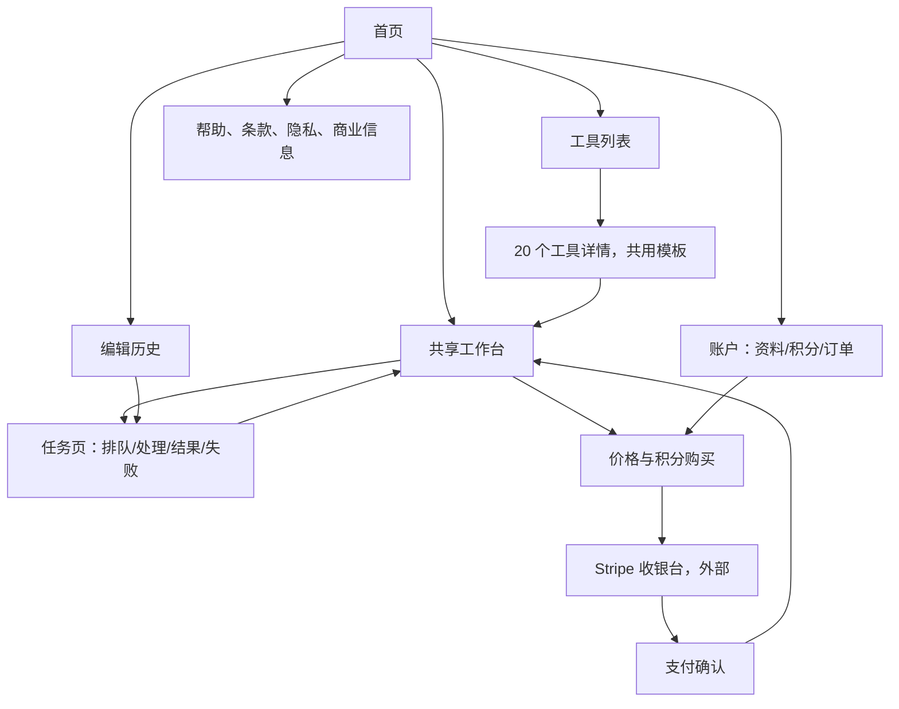

# 前端页面、功能入口与跳转设计

更新：2026-10-20。状态：开发前的信息架构提案，尚未创建页面或修改 API。依据 [需求基线](BASELINE_REQUIREMENTS.md)、[前端接口规范](../interfaces/FRONTEND_API_GUIDE.md)、现有工具配置和 [原体验资料](../../references/product/UX_SCREEN_SPEC.md)。本文将原资料中的页面构想落实为可计数的路由与用户路径；发生差异时应按本提案评审后同步实现，不把提案当作已上线能力。

分析采用 customer-journey-map：从首次使用、明确任务和老用户复用出发，分析入口、完成目标、断点及恢复。旅程与情绪均为当前产品假设，没有真实访谈或转化数据支持。

## 1. 数量结论及计数口径

首期建议 **14 类用户页面，使用 12 个 Next.js 页面模板**。其中工具详情模板生成 20 个工具 URL，法律/商业说明共用一个内容模板。展开后为 **32 个可枚举页面 URL，加按 job_id 生成的任务详情页**。

这三个数字分别表示产品职责、代码模板和访问地址，不是三种不同范围：

- 14 类职责 = 8 类核心产品页面 + 3 类账户/帮助页面 + 3 类法律/商业说明页面。
- 12 个模板 = 14 类职责中，3 类法律/商业说明合并使用 1 个模板。
- 32 个确定 URL = 11 个其他确定页面 + 20 个工具详情 + 1 个编辑工作台。任务详情按用户实际 job_id 产生，不限制为一个固定 URL。
- 任务的 queued、processing、completed、failed、cancelled 是同一任务页的状态；推荐列表、编辑参数、上传进度是工作台区域；订单和积分是账户标签页，不另计页面。
- / 到 /ja/ 的重定向、OAuth 回调、loading/error/not-found、弹窗、Stripe 托管收银台不计入本站常规页面数。固定 URL 不表示必须使用静态渲染或已经生成。
- 20 是当前工具目录数量。新增工具只增加配置和详情 URL，复用模板与工作台，不按效果数量扩建独立编辑器。

## 2. 页面总表

所有页面 URL 为拟开发的前端路由，不是现有 /api 接口。当前还没有这些前端页面运行实现。

| 编号 | 页面职责 | 前端路由 | URL 数 | 登录 | 主要入口 | 核心功能 | 主要去向 |
|---|---|---|---|---|---|---|---|
| P01 | 首页 | /ja/ | 1 | 公开 | 品牌/直接访问/外部分享 | 产品说明、开始编辑、工具分类、可信样例、价格入口 | 工作台、工具列表、工具详情、价格 |
| P02 | 全部工具 | /ja/tools | 1 | 公开 | 首页、主导航、工作台切换工具 | 搜索、四类筛选、20 工具、可用性 | 工具详情，或带所选工具进入工作台 |
| P03 | 工具详情 | /ja/tools/[toolId] | 20 | 公开 | 搜索落地、工具列表、相关工具 | 此任务的说明、样例、限制、FAQ、明确 CTA | 携带 tool_id 进入工作台，或登录后进入 |
| P04 | 共享编辑工作台 | /ja/edit | 1 | 需要 | 首页 CTA、工具详情、结果继续编辑 | 上传/多图角色、推荐、选择工具、参数、自定义要求、费用确认 | 创建成功后进入任务页；余额不足到价格 |
| P05 | 任务详情/处理/结果 | /ja/jobs/[jobId] | 按任务产生 | 需要 | 工作台生成成功、历史、刷新恢复 | 状态、queued 取消、完成后对比/下载/继续编辑、失败恢复 | 新一轮工作台、历史、账户/帮助 |
| P06 | 我的编辑历史 | /ja/history | 1 | 需要 | 主导航、任务页、登录后恢复 | 本人任务分页、状态、缩略图、重开任务 | 任务详情；无任务时进入工作台 |
| P07 | 价格/购买积分 | /ja/pricing | 1 | 公开浏览，购买需登录 | 导航、余额入口、生成余额不足 | 活跃套餐、日元价格、积分/退款说明、购买 | Stripe 托管收银台；退出购买返回原编辑 |
| P08 | 支付返回/确认 | /ja/billing/success | 1 | 需要 | Stripe success_url | 等待真实订单/余额更新，显示确认中/已到账 | 返回原编辑或账户订单 |
| P09 | 登录/注册 | /ja/login | 1 | 公开 | 受保护页面、顶部登录、购买前 | 统一登录/注册入口、会话恢复、邮件验证提示 | 安全 next 目标，缺省工作台 |
| P10 | 我的账户 | /ja/account | 1 | 需要 | 头像菜单、积分入口、价格/支付返回 | profile、credits、orders 三标签：邮箱/退出、余额、订单 | 价格、工作台、订单对应状态 |
| P11 | 帮助中心 | /ja/help | 1 | 公开 | 页脚、错误提示、工具 FAQ | 格式、隐私、生成/支付/下载帮助及运营联系信息 | 对应工具、价格、重新进入原流程 |
| P12 | 使用条款 | /ja/legal/terms | 1 | 公开 | 页脚、登录/购买说明 | 版本化条款内容 | 返回来源页 |
| P13 | 隐私说明 | /ja/legal/privacy | 1 | 公开 | 页脚、上传说明、登录说明 | 图片用途、保留/删除、服务处理说明 | 返回来源页 |
| P14 | 商业信息/退款说明 | /ja/legal/commercial-disclosure | 1 | 公开 | 页脚、价格、付款说明 | 经营主体、联系、计价/交付与退款说明 | 价格或返回来源页 |

P12–P14 的正式正文要与经营主体、实际数据处理、定价和运营政策一致，目前仅定义入口，不复用旧资料的假定价格或承诺。

### 12 个实际页面模板的位置提案

```text
apps/web/src/app/
├── page.tsx                         / → /ja/，只重定向，不计常规页
├── ja/
│   ├── page.tsx                     P01 首页
│   ├── tools/
│   │   ├── page.tsx                 P02 工具目录
│   │   └── [toolId]/page.tsx         P03，20 个当前工具
│   ├── edit/page.tsx                P04 共享工作台
│   ├── jobs/[jobId]/page.tsx         P05 任务与结果
│   ├── history/page.tsx             P06 历史
│   ├── pricing/page.tsx             P07 价格
│   ├── billing/success/page.tsx     P08 支付确认
│   ├── login/page.tsx               P09 登录/注册
│   ├── account/page.tsx             P10 账户与标签
│   ├── help/page.tsx                P11 帮助
│   └── legal/[document]/page.tsx    P12–P14 内容共用
├── auth/callback/route.ts            拟新增技术回调，不计页面模板
└── api/[...path]/route.ts            已有 API 入口，不在本轮开发
```

表中 12 个模板仅统计 ja 下 page.tsx；根重定向与回调不计。callback 的具体实现取决于 Auth SDK 登录模式；路径是预留设计，不表示现有后端提供此路由。legal document 只接受上表三个值，未知值返回 not-found。

## 3. 总导航和网站层级



图中省略需要时的登录拦截；登录完成回原目标，不统一扔回首页。

桌面主导航建议：Logo/首页、工具、开始编辑、编辑历史、价格；右侧为登录或头像/余额。移动端优先保留“工具、编辑、历史”三项主入口，顶部提供 Logo、余额和头像；帮助及法律内容放页脚，不用 20 项导航挤满首屏。

未登录也可以浏览首页、目录、全部工具详情、价格和帮助。历史和账户允许点击，但触发登录后回目标。所有入口以当前工具是否可用为准，目录能浏览不等于能生成。

## 4. 三条主要用户旅程

### A. 不确定效果：从首页开始

```text
首页“写真を編集する”
→ 未登录则登录并回工作台
→ 工作台选择照片、上传、complete
→ 展示推荐；无视觉推荐时明确回退，或浏览可用工具
→ 用户选择一个工具、确认参数和积分
→ POST /api/edit
→ 202 后进入 /ja/jobs/{job_id}
→ 处理中 → 完成/失败
→ 完成后对比、下载、继续编辑
```

首期不做匿名云上传。为避免 OAuth 整页跳转丢失 File/Blob，本提案在打开云上传流程前完成登录。首页可展示样例和产品价值，不宣称用户已经上传或模型已经理解照片。

推荐在工作台内部展示，不另建推荐结果页面。推荐慢或失败不阻断用户从工具目录选择；全部工具不可用时显示准备状态，不引导购买后保证能生成。

### B. 已有明确任务：从工具页开始

```text
外部搜索/工具列表
→ /ja/tools/hair_color（例如发色）
→ 了解样例、输入要求与限制
→ “このツールで編集”
→ 登录（如需要）
→ /ja/edit?tool=hair_color
→ 按该工具上传、配置参数并确认
→ 任务详情 → 下载/继续编辑
```

工具详情承担公开说明和可被检索的内容；交互执行进入统一工作台。无需每个工具重复实现上传、轮询和支付。进入工作台后保留所选工具，不要求重新寻找。

### C. 老用户复用：从历史开始

```text
编辑历史
→ 某个已有任务
→ 正在处理：继续查看，不再提交生成
→ 已完成：打开结果
→ “继续编辑”
→ /ja/edit?parent_job_id={job_id}
→ 读取父任务，验证 completed，并取 result_image_id 作 primary
→ 选择本轮效果/调整参数，确认新费用
→ 新任务、新幂等键 → 新任务详情
```

结果不存在、过期或已删除时，明确说明无法继续，用“重新上传照片”恢复；不偷偷改用原图冒充上次结果。版本关系来自任务 parent_job_id，不新建一套前端作品数据库。

### 用户旅程中的主要摩擦（假设，需后续 evaluation）

| 阶段 | 触点/动作 | 用户可能的想法和情绪 | 流失风险 | 页面处理 |
|---|---|---|---|---|
| 发现 | 首页/工具详情 | “能处理我的照片吗”，好奇但怀疑 | 没有真实样例、误导承诺 | 真实或明确标注的例图、清楚限制 |
| 决定尝试 | 公开页 CTA、登录 | “还没看到价值就要注册”，犹豫 | 注册过长、登录后丢目标 | 统一短登录、保留工具与 next；不重复问画像 |
| 上传与选择 | 工作台 | “传上去了吗，适合什么效果”，期待 | 格式不支持、推荐空白、照片丢失 | 明确三步上传状态；推荐回退；保留已固定 image_id |
| 费用确认 | 工作台、价格 | “这次花多少，失败怎么办”，谨慎 | 隐藏费用、跳转购买后草稿丢失 | 提交前明确积分；购买后恢复、再次确认 |
| 等待 | 任务页 | “关闭页面会不会丢”，焦虑 | 假进度、反复点击、双重扣费 | 持久 job URL、真实状态、queued 可取消 |
| 得到结果 | 同一任务页 | “效果好不好，能保存吗”，满意或失望 | 结果不可下载或不会继续 | 对比、下载、继续编辑；真实失败恢复 |
| 回访/传播 | 历史与保存后的照片 | “上次作品在哪”，希望复用 | 私有结果链接误作公开分享、资产过期 | 历史重开、过期说明；用户自行分享已下载图片 |

真正首次价值时刻是看到可接受并能保存的真实结果；获得推荐卡片或进入 queued 不能算达成。首期不加入公开作品社区来承担传播。

## 5. 各核心页面的内部区域和子状态

### P01 首页

保留一个主 CTA“开始编辑”，一个次入口“查看全部工具”。区域依次为价值/样例、四类工具、操作说明、价格摘要、隐私与 FAQ。匿名“最近使用”不承诺云端历史；登录后如展示近期任务，使用真实 jobs，不模拟最近作品。

不把首页变成第二个完整编辑器；它可以承接任务意图并进入工作台，避免两套编辑状态维护。

### P02/P03 工具目录与详情

四类来自当前目录：日常修图 6、人像社交 5、插画趣味 5、生活创意 4，共 20。类别用本地日语展示映射，不要求用户读后台中文分类。目录搜索/筛选为前端对 GET /api/tools 结果的处理，无独立搜索页或搜索 API。

工具详情建议使用 tool_id 为当前稳定 URL 标识；如以后采用日语/英文 SEO slug，再维护显式映射及旧地址重定向。tool_id 不可凭显示名称反推。

工具已注册但不可用：详情照常存在，标注状态、禁用生成 CTA；未知 tool_id：not-found。服务端能力不允许某参数/参考角色时，表单不展示或解释不可用，而不是先收图再提交注定失败的请求。

### P04 编辑工作台

一个页面覆盖以下区域，不拆成上传页、推荐页、参数页、多图页：

1. 图片区：主图、附加参考图、顺序/角色、逐图上传状态和移除操作。
2. 效果区：智能推荐或手动选工具，保留已上传图片。
3. 参数区：按工具配置渲染，允许补充自然语言要求。
4. 确认区：实际可用档位/比例、显示积分、余额和生成按钮。
5. 异常区：坏文件、未 ready、输入过多、余额不足、服务不可用等就地恢复。

移动端可用“照片→效果/参数→确认”的步进显示，但仍是同一路由与同一草稿，不再增加三张页面。切换步骤不触发生成；更换工具如不兼容现有参考图，先解释并让用户确认调整，不静默丢图。

“自由编辑”首期体现为已选工具下的“自定义要求”。现有 POST /api/edit 必须有 tool_id，不能仅凭一句话无工具地生成；若以后需要完全自由意图解析，先增加协议与服务能力，再单独论证是否需要入口。不为目前不支持的能力创建承诺式页面。

### P05 任务页与结果页合一

唯一可靠地址为 /ja/jobs/{job_id}。queued/processing 显示状态和允许的操作；completed 原地切换为结果比较、下载和继续编辑；failed/cancelled 原地给恢复路径。查询刷新不会重新 POST edit。

“再生成一次”：返回工作台供确认并创建新 key；不能用旧 key 声称重新生成。“继续编辑”：以本次结果作为新输入，并显式保留父关系。“换个效果”：同样回工作台选择，用结果或原图必须有用户可见的选择，不能混淆两者。

完成后不自动跳另一张结果页面，避免刷新、深链与返回历史产生两套 URL。首次来自工作台时“返回编辑”回草稿；来自历史时“返回历史”回列表。浏览器后退不自动创建任务。

### P06 历史

列表有空、加载、分页、错误、部分资源过期状态。点击任一记录只进任务详情；缩略图加载失败不把整个任务历史标成不存在。

状态筛选若提供，必须标注只筛当前已加载结果，或另行增加服务端筛选契约；当前 GET /api/jobs 只支持 limit/cursor，不承诺完整历史搜索。首期建议不加入跨全历史筛选。

删除图片放结果页的确认操作，不把删除历史卡片伪装成删除 job。当前没有删除 job、删除整条编辑链或清空历史 API。

### P07/P08 价格与支付

价格页公开可读，购买要登录；一次性积分包优先，不展示没有后端支持的订阅开通、续费和取消入口。套餐空时显示尚未开放购买，不写死假价格。

发起 Checkout 前保存 order_id、回到哪里以及当前用户下的编辑上下文。success 回跳页面仅做确认：pending 时显示确认中，查询 orders/credits；paid 后显示到账并提供“返回编辑”“查看订单”按钮。保持用户控制，不自动再次发 edit。

当前 Stripe 退出收银台固定回 /ja/pricing，不带恢复参数。价格页通过当前会话保存的上下文提供“返回刚才的编辑”；pending 不等于失败，退出也不等于订单被服务端取消。

如果跳转前记录丢失，session_id 不能当 order_id，也不能把最新订单直接断定为本次订单；显示订单历史/余额并允许手动确认。跨设备精确恢复支付会话需要补充服务端关联接口，暂不承诺。

### P09 登录/注册

建议首版使用 Google + 邮箱验证码/链接，统一入口，登录/新用户创建与“查收邮件”作为同页状态，不强制增加注册页。具体 Auth provider 开启情况仍由环境配置决定，未启用的方式不展示。

若架构后续选择密码登录，则需补忘记密码/重设密码流程；目前不计入 14 类，不能一边提供密码登录一边省略恢复。OAuth 技术 callback 处理成功、过期、取消等，最终安全返回 next 或显示可重试状态。

### P10 账户子页面以标签组织

- /ja/account?tab=profile：邮箱、登录信息、退出；当前不承诺修改邮箱/昵称/头像或账户删除已接通。
- /ja/account?tab=credits：GET /api/credits 的可用、预留和限制状态，购买入口。
- /ja/account?tab=orders：GET /api/orders 的分页、金额、支付/退款状态；详情可展开卡片。

三个标签共用一个页面模板，不计三个独立子页面。当前没有积分流水 API 或单订单详情 API，因此不展示假的逐笔积分账单或链接到不存在的订单页。

### P11 帮助与 P12–P14 内容

帮助用单页锚点和折叠问答，覆盖上传、效果限制、排队、积分、支付、下载、过期/删除和联系。不要为每个 FAQ 单独建路由。联系入口采用确定的运营联系方式；不做没有收件系统的“提交成功”工单表单。

内容页可复用排版和页脚，明确更新时间。首期不增加尚无内容运营计划的博客列表和文章详情模板；后续真实有文章再增加，不能为了 SEO 填充空栏目。

## 6. 跳转、草稿和登录返回规则

| 场景 | 跳转及保留 | 禁止行为 |
|---|---|---|
| 未登录点击开始编辑 | /ja/login?next=编码后的工作台路径；登录后回去 | 登录后统一返回首页导致工具丢失 |
| 从工具详情进入 | /ja/edit?tool={tool_id} | 再要求用户重新找相同工具 |
| 页面内换工具/步骤 | 原工作台更新选择和 UI 状态；必要时替换 query | 每次都重建上传资产或自动生成 |
| 生成返回 202 | /ja/jobs/{job_id} | 按按钮次数创建多个 job |
| 请求超时未拿到 job_id | 保留相同请求/幂等键，查询恢复或同键重试 | 直接换 key 盲重发 |
| 余额不足 | 到价格并保存当前编辑上下文；可先退出购买回草稿 | 丢弃照片或自动扣款 |
| 支付已确认 | 回原工作台并刷新余额，用户再次点击确认生成 | 回跳直接自动执行旧请求 |
| 任务页刷新 | 依据 URL 重新 GET job，不 POST edit | 把读取详情当成新生成 |
| 任务 completed 后继续 | /ja/edit?parent_job_id={job_id}，取父结果 primary | 用旧输入冒充父结果 |
| 取消/删除 | 就地确认，成功刷新状态/余额；必要时回历史 | 把关闭标签页视作任务取消 |
| 访问他人/失效资源 | 显示不可访问/已失效并给历史或重传入口 | 透露他人的图片是否存在 |
| 登出/换账号 | 清除该账号的临时草稿、支付返回上下文和私有缓存 | 将上个用户的草稿当成新用户内容 |

next 只接受受支持的本站相对路径；拒绝外站 URL、协议相对 URL 和不在允许范围的回跳，防止开放跳转。回调身份交换不能绕过 API 的 Supabase token 验证。

工作台 UI query 当前建议只放 tool、parent_job_id 等标识，不放图片字节、签名 URL、完整个人要求或服务 token。query 不是授权，服务端仍验证真实归属与能力。

草稿首期是前端临时会话状态，尚无服务端 draft API。可在当前用户作用域内临时保存已固定 image_id、顺序/角色、工具/参数、必要文本与原幂等键；原始 File/Blob 不作为刷新后可保证恢复的数据。跨 OAuth/Stripe 导航前保存必要上下文，返回时重新校验所有资产是否 ready/未过期；退出账号时清理，不保证跨设备恢复。

草稿中的上传未完成部分、被删除或过期的图需要重选/重传，不能保证刷新后无损。任何自动化恢复只恢复表单和可查询任务，不自动发起新的付费请求。

## 7. 组件/弹窗，不增加常规页面

| 交互 | 实现形态 | 原因 |
|---|---|---|
| 分类、工具搜索 | 工具列表筛选 | 当前没有独立搜索服务 |
| 推荐卡片、参考图角色 | 工作台区域 | 与当前图片/工具强关联 |
| 上传/校验进度、参数确认 | 工作台状态/移动步进 | 保持一个草稿 |
| 登录后查收验证码/邮件 | 登录页状态 | 不多建注册/激活完成页 |
| 取消任务、删除图片 | 确认弹窗/移动抽屉 | 高关联的短操作 |
| 积分不足 | 工作台提示与价格跳转 | 需要购买时才离开 |
| 对比、下载菜单、过期重取 | 任务页区域 | 与具体 job_id 关联 |
| 订单信息展开 | 账户 orders 标签卡片 | 无单独订单详情 API |
| 加载、离线、空数据、404、500 | 页面/布局状态组件 | 状态不计业务路由 |

不在此时增加独立“上传成功页”“推荐完成页”“生成成功页”“取消成功页”“支付失败页”。这些状态需要明确展示，但不需要各自形成一条常规路由。

## 8. 页面与现有接口的对应及缺口

| 页面/能力 | 可接入接口/来源 | 当前状态及设计约束 |
|---|---|---|
| 首页、工具目录、详情 | GET /api/tools + 服务端公开内容配置 | 已有 API；工具介绍/样例/FAQ/SEO 内容还需要前端内容整理，不能从完整 Prompt 公开生成 |
| 登录 | Supabase Auth SDK，GET /api/me | 需要配置真实 Auth；OAuth callback/浏览器会话仍需开发 |
| 工作台上传 | upload-url → R2 PUT → complete；GET image | API 已有，真实浏览器/R2 CORS 仍待联调 |
| 推荐 | POST /api/recommend | 代理和明确回退已有，GPU 服务未部署；全不可用时为空 |
| 参数与生成 | GET tools、POST /api/edit、GET credits | 创建 queued 已有；必须有 tool_id，默认生成关闭 |
| 任务详情 | GET job、cancel、GET image/download | 查询/queued取消已实现；真实生成、结果保存与结算待 Worker |
| 历史 | GET /api/jobs，逐图按需读取 | 没有全局图片列表、任务删除、服务端搜索或状态筛选 |
| 购买和支付确认 | packages、checkout、orders、credits | 真实 Stripe 环境/套餐仍待配置；success/cancel 路径已由后端固定 |
| 账户 | GET me、credits、orders；Auth logout | 无普通资料修改、积分流水、单订单详情或自助账户删除接口 |
| 帮助/内容 | 静态/受控文档内容 | 无客服工单、反馈写入或公开分享服务 |

当前无需为上述 14 类页面新增核心业务 API 才能开始前端；页面中未来能力要保持明确状态。若产品决定开放自由意图路由、保存反馈、公开作品分享、服务器草稿/跨设备恢复、积分流水、账户资料修改等，则应先补接口设计再实现对应入口。

## 9. 第一轮前端开发顺序

| 波次 | 交付 | 可先验证什么 | 不应被误认为完成 |
|---|---|---|---|
| F0 | 12 模板路由骨架、共用导航、API 客户端、认证/回跳状态 | 公开页和受保护页跳转、深链和返回 | 不是已接通真实生成 |
| F1 | 共享工作台 + 任务页 + 历史，先真实接上传/查询/取消 | 单图/多图表达、输入归属、刷新与幂等恢复 | 不能模拟 completed 充当 Worker 交付 |
| F2 | 工具列表及 20 个详情内容，完善四类参数差异 | 覆盖 20 工具、可用状态和共享 UI | 详情存在不等于效果 evaluation 已通过 |
| F3 | 价格、支付确认、账户三标签、帮助/法律内容 | Stripe 沙盒购买回跳、到账后恢复草稿 | 没有生产账户和政策确认不宣称开放收费 |
| F4 | Worker 接入后的真实全流程、移动端及异常验证 | 生成、结果下载、父结果继续编辑、失败结算 | 本地 fixture 不计真实效果通过 |

以上是前端内部执行顺序，不另行替换整体 DEVELOPMENT_ROADMAP 的 milestone。博客、公开作品页、订阅、后台管理和精细专业编辑器不计本轮，后续有实际需求和接口时再扩展。

## 10. 页面/跳转验收要点

1. 未登录能查看 20 个工具详情；开始上传前完成认证，并保留工具意图。
2. 全部四类、20 工具均进入目录/详情/工作台设计，不因先验证少量链路缩减首期范围。
3. 智能推荐、明确工具、历史复用三条路径共享工作台和 job 详情，不出现独立重复编辑器。
4. 多图合成能表达至少两张图片、顺序和角色；不能只画单图界面后声称覆盖多图。
5. 重复点击和网络重试不重复扣费；刷新、后退和支付回跳都不会自动再次 POST edit。
6. queued/processing/completed/failed/cancelled 在同一 job URL 正确展示；关闭页面不取消任务。
7. 支付 pending 与 paid 区分，成功回跳不自行加积分；退出支付能回到编辑上下文。
8. 不可用工具、空套餐、空推荐、图片过期和他人资源有真实恢复路径，不能用假结果覆盖。
9. 账户不同标签使用当前存在接口；尚无能力的操作不显示“已完成”式按钮或假工单。
10. 目录和 URL 保持可扩展；新增第 21 个工具不需要新建一套编辑和结果流程。
