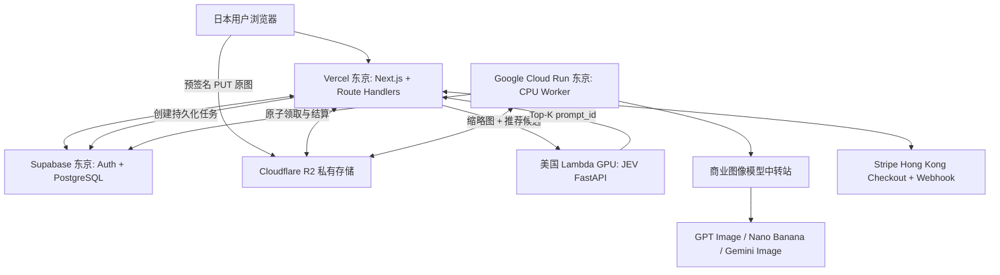

> 2026-10-19 implementation update: [Interface v1](../../docs/interfaces/INTERFACE_SPEC_V1.md), [Vercel backend](../../docs/backend/VERCEL_BACKEND.md), [Worker design only](../../docs/architecture/CLOUD_RUN_WORKER_DESIGN.md), [JEV design only](../../docs/architecture/JEV_LAMBDA_DESIGN.md). These documents supersede conflicting earlier examples. No cloud deployment; generation defaults to disabled.

> **范围决策（2026-10-19，用户确认）：首期从完整 20 个工具开始论证技术架构。** 分批开发、灰度或质量暂缓公开不缩减设计范围。统一清单与优先级见 [BASELINE_REQUIREMENTS.md](../../docs/product/BASELINE_REQUIREMENTS.md)。
> 本文影响：以 20 工具能力矩阵审查现有拓扑，覆盖多图、保真、版本与任务恢复；部署选择仍待论证。

# 完整系统架构与部署

> 文档基线：2026-10-19。面向日本普通消费者；香港公司经营；首期使用商用图像 API；以下“目标”不是已通过实测的指标。

## 部署拓扑

## 组件职责与代码部署

| 服务 | 代码/数据 | 运行责任 |
|---|---|---|
| Vercel | `apps/web`、仅服务端加载 `packages/prompts` | 日语 UI、SEO、会话校验、签发 R2 URL、Prompt 组装、Stripe Webhook、任务创建与查询 |
| Supabase | `supabase/migrations`；Auth/Postgres 托管 | 账户、订单、积分原子事务、图片 ID/所有权、任务持久化；不是承载大量 HTTP 应用代码的服务器 |
| Lambda GPU | `apps/jev-service` | 接收受认证推荐请求、加载缩略图、候选评分、返回 ID；不存完整 Prompt，不生成编辑图片 |
| Cloud Run | `apps/worker` | 持久任务消费、调用中转商、下载校验结果、写 R2、结算；无需 GPU |
| R2 | 无自定义业务代码 | 私有原图、分析缩图、版本结果；短期访问 URL |
| Stripe | 第三方托管 | 日元 Checkout、真实支付事件与退款，香港企业开户资格需确认 |

## 首期部署策略

- 单个 GitHub Monorepo，Agent 分 Worktree，按目录 CI/CD 独立部署。
- 推荐环节：前端本地创建 512–768px 缩图；可经 Vercel 流式转发给 Lambda，与原图上传 R2 并行。也支持 Lambda 使用受限 R2 签名 GET URL；择优实测。
- 生成环节：从已在 R2 的原图创建 `edit_job`；Cloud Run 读取快照；上传/返回结果不能依赖浏览器连接。
- Cloud Run Service 不应依赖 HTTP 响应结束后后台持续运行。通过受认证 HTTP 触发并完成工作；若使用 PG 表轮询，需要独立定期触发/保活或后续 Cloud Tasks。
- 初期 `edit_jobs` 表持久化队列 + 原子 claim + 超时恢复足够；增长后再评估 Cloud Tasks。

## 重要安全边界

- 浏览器永远不得获取 Stripe Secret、Supabase Secret、R2 管理密钥、中转商密钥、Lambda 私有 Token 或完整后台 Prompt。
- 图片对象为私有，签名 URL 限用途和时效；读取 Lambda 或供应商前确认用户归属及供应商数据处理条款。
- Vercel/Lambda/Worker 间强认证，Lambda 输入只允许可信图像来源，杜绝任意 URL SSRF。
- 区域部署 ≠ 数据驻留保证。R2 APAC 位置提示不保证图片仅位于日本；敏感合规根据实际服务协议复核。
