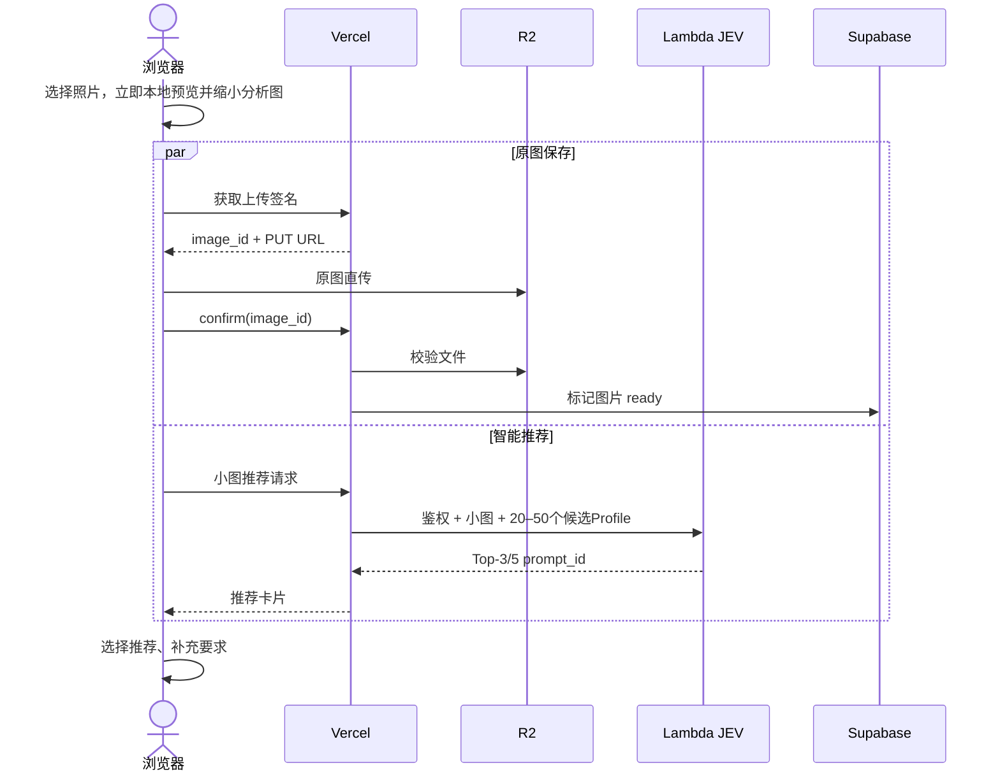
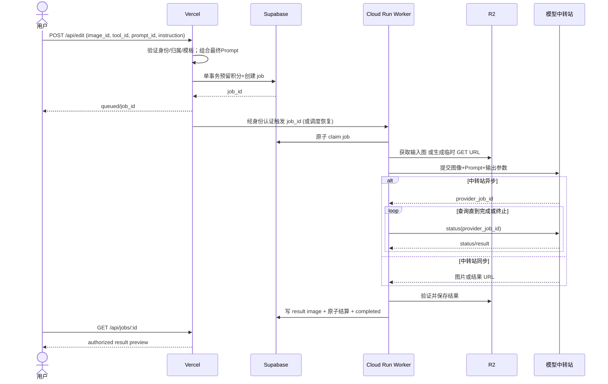

> 2026-10-19 implementation update: [Interface v1](../../docs/interfaces/INTERFACE_SPEC_V1.md), [Vercel backend](../../docs/backend/VERCEL_BACKEND.md), [Worker design only](../../docs/architecture/CLOUD_RUN_WORKER_DESIGN.md), [JEV design only](../../docs/architecture/JEV_LAMBDA_DESIGN.md). These documents supersede conflicting earlier examples. No cloud deployment; generation defaults to disabled.

> **范围决策（2026-10-19，用户确认）：首期从完整 20 个工具开始论证技术架构。** 分批开发、灰度或质量暂缓公开不缩减设计范围。统一清单与优先级见 [BASELINE_REQUIREMENTS.md](../../docs/product/BASELINE_REQUIREMENTS.md)。
> 本文影响：图像链路覆盖全部 20 工具；多图的每张输入与连续编辑版本均需校验归属，单图示例不构成输入限制。

# 上传、推荐、生成与交付完整链路

> 文档基线：2026-10-19。面向日本普通消费者；香港公司经营；首期使用商用图像 API；以下“目标”不是已通过实测的指标。

## A. 首页推荐路径（并行优化）

注意：推荐可能早于原图上传完成；点击正式编辑前必须确认 `image_id` 的 `ready` 状态。720p/缩略图和网络时延不能用固定数字承诺；JEV 的 200–500ms 是用户提供的经验值，需区分纯推理和端到端。

## B. 直接工具页面

Google 搜索 `写真をイラスト化` → `/ja/tools/photo-to-illustration` → 上传原图→预设 `tool_id`/`prompt_id`→可以跳过 JEV→提交 `/api/edit`。避免让已明确有目标的用户多等待一次推荐。

## C. 统一生成链路

## 文件边界

- `image_id` 是逻辑身份。`storage_key` 存后端元数据；R2 私有图片使用短期签名 URL。
- 上游中转商可能接受 URL / multipart / base64；Provider Client 做格式转换，不用为了“统一接口”建设大量模型路由。
- 结果上传后由 Worker 检查媒体类型、文件大小、尺寸、可读性；成功后保存用户可下载的新版本。
- 后端状态 `queued/processing/completed/failed/cancelled`，浏览器只展示可靠状态，不伪造进度百分比。
- 多轮继续编辑：上一版本图片作为新任务输入，保留 `parent_image_id`、原始版本、每次任务 Prompt 快照。

## 失败/重试边界

1. 未拿到上游任务 ID 且调用超时：结果不确定；先根据供应商幂等键/查询能力确认，避免盲目重试导致重复收费。
2. 上游已完成但保存 R2 失败：任务不可标记 completed；尝试恢复结果，最终失败按规则释放积分并记录平台损失。
3. Worker 崩溃：基于 `lease_expires_at` 重新领取；上游 `provider_job_id` 已存在则先恢复原任务。
4. Vercel 创建任务后触发 Worker 失败：周期性扫描 queued job 补触发。
5. 取消操作仅在未进入不可撤销上游阶段时保证有效；其它阶段明确告知用户。

## MVP 观测点

`client_preview_ms`, `upload_ms`, `recommend_network_ms`, `jev_inference_ms`, `queue_wait_ms`, `provider_generation_ms`, `result_storage_ms`, `end_to_end_ms`, `provider_cost`, `user_downloaded`。避免在普通日志中保存图片、签名 URL 或个人 Prompt 全文。
